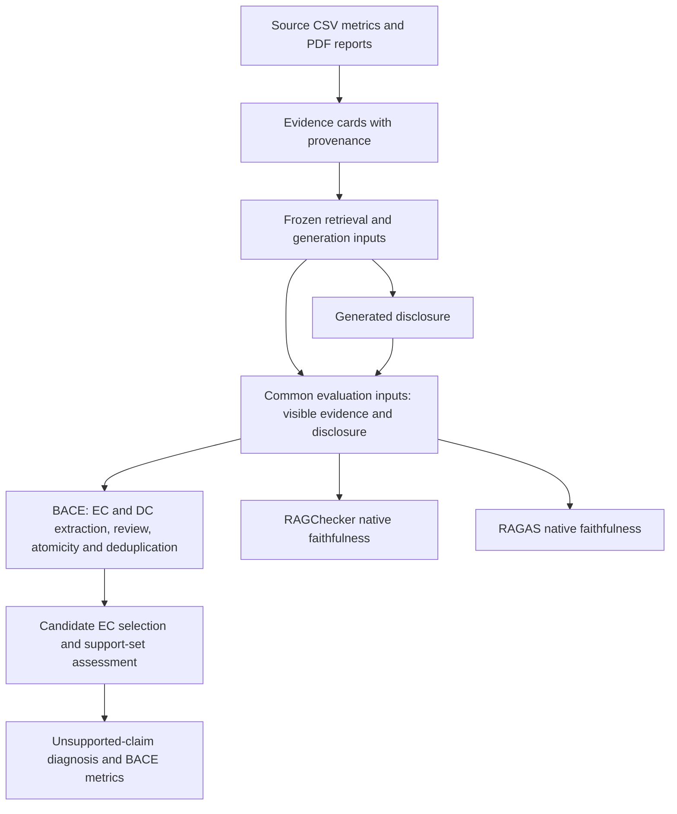

# BACE: Boundary-Aware Claim Evaluation

BACE evaluates how well a generated sustainability disclosure is supported by the evidence supplied to its generator. It reconstructs relationships between **evidence claims (ECs)** and **disclosure claims (DCs)** to answer three questions: which disclosure claims are supported, how much of the supplied evidence is used, and why unsupported claims fail.

This directory contains the research implementation and a frozen experiment comparing BACE with the native faithfulness metrics of RAGChecker and RAGAS. Evaluation requires no reference disclosure. Its evidence boundary is the material actually shown to the generator; scores measure support within that boundary, not real-world truth or ESRS compliance.

## Start here

| Goal | Entry point |
|---|---|
| Understand the framework | [Method definition](../docs/generation_evaluation.md) |
| Understand the experiment design | [Frozen protocol](PROTOCOL.md) and [experiment configuration](config/experiment.json) |
| Read the analysis and figures | [Analysis guide](analysis/README.md) |
| Run or resume the experiment | [Setup](#setup) and [experiment commands](#run-and-resume-the-experiment) below |
| Check engineering acceptance | [Readiness report](READINESS.md), regenerated by `run.py check` |
| Conduct formal human review | [Human-validation guide](analysis/validation/README.md) |

**Recorded workspace status, inspected on 2026-09-27:** engineering acceptance passed for the frozen preparation and twelve-case pilot. The saved main-run snapshot reports **1,798 completed cases and two failures**, with status `incomplete`; the official main-run summary has not been generated. Descriptive analysis notebooks and formal reviewer packets are available. Packet preparation does not establish that human annotation or evaluator validation has been completed.

For subsequent execution status, inspect `results/main_v1/execution_status.json` with `monitor.py --once`. Readiness authorizes the main run; it does not certify main-run completion or scientific validity.

## Experiment at a glance

| Component | Frozen design |
|---|---|
| Cases | 30 companies × five reporting years (2019–2023) × twelve tasks = **1,800 disclosures** |
| Sampling | 30 companies across eleven SICS sectors, drawn from 250 source-eligible companies in a 600-company register |
| Tasks | 2023 ESRS edition: E1-1/3/4/6, S1-1/4/5/14 and G1-1/2/3/4 |
| Evidence for target year `t` | CSV metrics from `t−4` through `t`; PDF reports from `t−4` through `t−1` |
| Retrieval | BM25 and `text-embedding-3-large` vectors, reciprocal rank fusion, up to ten cards each from narrative text, PDF table rows and CSV metrics |
| Generation | Azure `gpt-5.6-sol`, medium reasoning, first complete 300–500-word response meeting the length contract |
| Evaluators | BACE; RAGChecker 0.1.9 / RefChecker 0.2.13; RAGAS 0.4.3 |
| Engineering pilot | Twelve prespecified cases, one per task, using the main experiment's code and settings |

All 150 company-year evidence packages and 1,800 generation inputs are prepared before the main run. Tasks are independent: generated text from one case is never evidence for another. See [PROTOCOL.md](PROTOCOL.md) for sampling, source exclusions, retrieval parameters, model settings and failure policies.

## How evaluation works



BACE assesses whether candidate ECs support each DC while preserving material boundaries such as entity, time, scope, metric and certainty. A DC is classified as directly supported, supported by inference, or unsupported. Unsupported DCs receive one of six diagnoses: non-disclosure statement, contradiction, evidence conflation, factual boundary distortion, inferential inflation or unsupported novelty. Native model replies, claim provenance, review lineage and support sets remain available for inspection.

The primary BACE metrics are implemented in [metrics.py](script/evaluation/metrics.py):

| Metric | Meaning and denominator |
|---|---|
| All-DC support rate | Directly supported plus inferred-supported DCs / all deduplicated DCs |
| Evidence claim coverage (ECCR) | Distinct ECs used in any accepted support set / all deduplicated ECs extracted from the supplied evidence |
| Inference rate | Supported DCs with only inferred support sets / all supported DCs; undefined when none are supported |

The support rate excluding unsupported non-disclosure statements is a separately labeled sensitivity metric. Framework comparisons retain each evaluator's native claim inventory and report both case-level macro averages and claim-level micro rates. RAGChecker and RAGAS receive the same visible evidence and disclosure as BACE, but use their own segmentation and scoring; a higher native score does not establish greater evaluator accuracy.

## Setup

### Existing prepared workspace

From the repository root:

```bash
cd BACE
.venv/bin/python run.py --help
.venv/bin/python monitor.py --once
```

All experiment commands below assume this working directory. `run.py` also accepts an absolute path and resolves its project directory automatically, so it can be invoked from elsewhere.

### New environment and required data

Use Linux with Python 3.11 and `uv`; the recorded freeze uses **Python 3.11.16**. The scheduler relies on POSIX process groups and file locks. For a new environment, from `BACE/`:

```bash
uv venv --python 3.11.16 .venv
uv pip install --python .venv/bin/python --torch-backend cpu -r requirements.lock.txt
```

[requirements.txt](requirements.txt) lists direct dependencies; [requirements.lock.txt](requirements.lock.txt) pins the installed packages. Model inference uses remote Azure deployments, so no local GPU is required. The freeze checks the exact interpreter, installed package inventory and service routing. Installing dependencies alone is not sufficient to reproduce an accepted run.

Source data, prepared evidence, result artifacts, environments and credentials are ignored by Git. A source checkout alone therefore cannot reproduce the recorded experiment. Obtain the corresponding local data and frozen artifacts before running it. Preparation expects these paths relative to the repository root:

- `data/raw/datasets/companies.csv`: company register and sector metadata.
- `data/raw/datasets/indicator_metadata.csv`: indicator definitions.
- `data/processed/results/esg_indicators_postprocessed.csv`: extracted ESG metrics.
- `data/raw/reports_pdf/`: source reports with their recorded company/year filenames.

A prepared run uses the retained `BACE/evidence/` artifacts and locally copied implementations in `BACE/script/`; it does not import code from the archived project stage. Source provenance and acceptance checks still rely on the corresponding original data.

Configure a local, ignored `BACE/.env`. For **each** prefix below, provide `<PREFIX>_AZURE_OPENAI_ENDPOINT`, `<PREFIX>_AZURE_OPENAI_DEPLOYMENT` and `<PREFIX>_AZURE_OPENAI_API_KEY`:

| Prefix | Service role |
|---|---|
| `GENERATION` | Disclosure generation |
| `CLAIM_EXTRACTION` | EC/DC extraction and reviews |
| `CLAIM_DEDUP` | Semantic deduplication |
| `CLAIM_CANDIDATE` | Candidate evidence selection |
| `CLAIM_SUPPORT` | BACE support, RAGChecker and RAGAS |
| `CLAIM_DIAGNOSIS` | Unsupported-claim diagnosis |
| `TEXT_EMBEDDING_3_LARGE` | Evidence and query embeddings during preparation |

The exact checks are in [acceptance.py](script/acceptance.py). Credentials are not stored in manifests; deployment and endpoint identities are hashed. Continuing an existing freeze requires compatible routing and artifacts. A substantive protocol change requires a separately identified experiment version and a new acceptance run.

## Run and resume the experiment

### Acceptance and execution

```bash
# Revalidate preparation, frozen inputs/environment and the completed pilot.
# Makes no model calls; regenerates the readiness reports.
.venv/bin/python run.py check

# Run or resume the twelve-case engineering pilot (uses model APIs).
.venv/bin/python run.py pilot

# Run or resume all 1,800 main cases (uses model APIs).
.venv/bin/python run.py main
```

`main` requires a passed `readiness_report.json` tied to the current freeze and rechecks frozen inputs and the environment. A successful import or help command does not establish readiness. The pilot must finish before acceptance can pass; the commands above describe the available operations, while the preparation sequence below gives their initial execution order.

Rerun the same `pilot` or `main` command after an interruption. Completed stages are reused only when their recorded command, code and output hashes match. Failed calls remain logged and are retried; successful branches survive sibling failures. Run and case locks prevent concurrent ownership of the same outputs.

In an interactive terminal, execution uses an eight-row alternate-screen display refreshed every two seconds. Press **Ctrl+C once** to stop scheduling and terminate active stage subprocess groups while preserving resumable outputs. `COMPLETE` appears only after all cases, final checks, official summaries and generated human-review materials succeed.

### Detached execution and monitoring

To keep a main run active after SSH disconnection:

```bash
mkdir -p results/main_v1
nohup .venv/bin/python -u run.py main > results/main_v1/runner.log 2>&1 < /dev/null &
.venv/bin/python monitor.py
```

After reconnecting, run only the viewer. It reads existing records, creates no monitoring files and makes no model calls. Ctrl+C closes the viewer without stopping the experiment. To stop the runner, send `kill -TERM <PID>` using its displayed experiment PID.

```bash
.venv/bin/python monitor.py --once
.venv/bin/python monitor.py --scope pilot
.venv/bin/python monitor.py --api
.venv/bin/python monitor.py --api support
.venv/bin/python monitor.py --api diagnosis
```

The default scope is `main`; `--api` alone selects candidate selection. Snapshots older than fifteen seconds are marked stale. Startup/final summaries and unexpected runner errors go to `runner.log`; detailed logs and stage receipts remain under the case directories.

The API viewer reads the local coordinator in read-only mode and observes newly appended call records. Allow 30–60 seconds for a throughput sample; `--api --once` shows the current gate without a throughput interval. Its limits, in-flight leases, pacing and cooldown describe local scheduling. Successful jobs/minute and reported successful-job tokens/minute describe observed completions, not Azure quotas or billing. Timing estimates are based on completed calls and local/provider timestamps, not direct measurements of Azure queues. Exact waiting-queue depth and provider quota balances are unavailable.

### Runtime controls

The frozen configuration permits **16 concurrent cases**. After generation, BACE, RAGChecker and RAGAS run concurrently within each case. BACE preserves stage dependencies; independent EC/DC extraction and deduplication jobs run concurrently, and candidate/support/diagnosis stages each use up to eight claim workers per case.

[claim_execution.json](config/claim_execution.json) sets global request ceilings of 16 for generation, 32 for extraction/reviews, 32 for deduplication, 64 for candidates, 48 for shared support/RAGChecker/RAGAS, and 32 for diagnosis. These are local limits, not Azure quotas. A shared `Retry-After` cooldown reduces concurrency and slows request starts after rate limiting, then gradually restores capacity. The SQLite coordinator uses `/dev/shm`, with local temporary storage as fallback, to avoid project-NFS locking problems.

## Outputs and analysis

| Location | Contents |
|---|---|
| `config/` | Protocol configuration, task/query definitions, prompts, schemas and `freeze.json` |
| `evidence/` | Sampling records, source provenance/exclusions, canonical cards, annual packages, vector index and frozen generation inputs |
| `results/pilot_v1/`, `results/main_v1/` | Run manifests, execution status, per-case inputs, raw outputs, logs and resumable stage receipts |
| `results/<scope>_v1/analysis/` | Official `comparison.csv`, `group_summary.csv` and `summary.json`, generated only after every selected case completes and validates |
| `results/<scope>_v1/human_validation/` | Blank review materials generated by the original experiment summarizer |
| `analysis/` | Four descriptive notebooks, their separate environment, figure/table exports and QA records |
| `analysis/validation/` | Subsequent formal 600-claim reviewer packets and their current annotation guide |
| `script/`, `tests/` | Preparation, generation/evaluation and orchestration code; failure-oriented contract checks |

The runner calls the official summarizer automatically. To regenerate summaries from a fully completed run:

```bash
.venv/bin/python run.py summarize --scope main
```

This command validates the planned cases and their artifacts and refuses an incomplete comparison. It also prepares human-review materials and protects changed annotations from overwriting. `--scope pilot` summarizes the pilot; omitting `--scope` defaults to `pilot`.

The separate [analysis workflow](analysis/README.md) reads saved artifacts and uses the common completed cohort for paired comparisons, retaining missingness. Read its notebooks in this order:

1. [Data landscape](analysis/00_data_landscape.ipynb): sources, sampling, geography and evidence availability.
2. [Evidence support](analysis/01_evidence_support.ipynb): score distributions and heterogeneity.
3. [Failure patterns](analysis/02_failure_patterns.ipynb): automated diagnoses and traceable examples.
4. [Evaluator comparison](analysis/03_evaluator_comparison.ipynb): native scores, segmentation and disagreements.

Code-hidden HTML reading copies, PDF/SVG/PNG figures, source tables and QA records are under `analysis/outputs/`. These are post-experiment descriptive analyses, not a preregistered analysis plan. Reproduce them using **`analysis/.venv`**, following the analysis guide and its renderer prerequisites; installing analysis packages in the frozen experiment environment would invalidate its dependency identity.

For formal human review, follow [analysis/validation/README.md](analysis/validation/README.md). Two independent reviewer workbooks contain the same 600 DC/candidate-EC samples for support classification and, conditionally, unsupported-type classification. Reviewers receive their assigned blank workbook and guide; coordinator files containing automated answers remain separate. This study assesses decisions conditional on BACE's supplied claim inputs, rather than independently validating extraction, candidate recall or the entire pipeline.

## Rebuild preparation

With the required data, environment and service configuration in place, the preparation sequence is:

```bash
.venv/bin/python run.py sample
.venv/bin/python run.py prepare-evidence
.venv/bin/python run.py prepare-inputs
.venv/bin/python run.py freeze
.venv/bin/python run.py pilot
.venv/bin/python run.py check
```

These commands do not start the main experiment. `prepare-inputs` makes embedding requests when compatible vectors or query caches are unavailable; `pilot` makes generation and evaluation calls. PDF extraction, embedding batches and per-case retrieval support verified cache reuse. An incompatible existing sample or freeze is rejected rather than silently overwritten. Temporary extraction/retrieval caches are removed after successful preparation; retained canonical evidence and frozen inputs support the main run.

## Interpretation limits

- **Support is conditional on supplied evidence.** A supported claim can faithfully repeat an erroneous source metric. BACE does not establish external truth, disclosure completeness, materiality or legal compliance.
- **Source availability affects the population.** Selection represents the complete-source subpopulation; conclusions about all 600 registered companies require additional assumptions about missingness.
- **Report years are not publication dates.** Historical PDF windows do not establish an exact historical information-availability cutoff.
- **Extraction and judges remain fallible.** Engineering acceptance verifies executable, auditable processing. It does not prove every extracted claim, support judgment or diagnosis correct.
- **Native scores have different denominators.** Differences between BACE, RAGChecker and RAGAS cannot by themselves establish comparative accuracy; formal human labels have their own specified validation scope.
- **Frozen inputs do not make remote models deterministic.** Provider changes and retry variation can affect future responses. The project preserves inputs, routing identities, raw replies and lineage to make the recorded run auditable.
