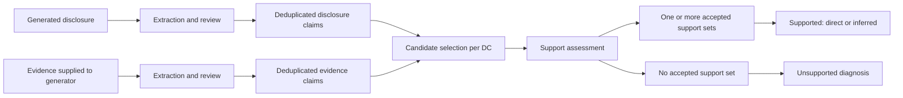

# BACE Interaction Design

Date: 2026-10-22

Status: Historical design proposal grounded in the then-current BACE implementation and one inspected saved case. An interactive prototype has since been built; no usability study has been conducted.

Revision notice: The author found the resulting concepts too dense and tiring to read. Both this layout and the subsequent [v2 proposal](bace_interaction_design_v2.md) are superseded by the author's four-column sketch and the [Product Baseline](bace_product_baseline.md), dated 2026-10-23. Retain this document for the underlying data relationships and historical implementation findings; use the baseline for current product direction and acceptance criteria.

## Product intent

Create a desktop research workspace that lets a reader trace a generated disclosure through disclosure claims, evidence claims, candidate selection, support assessment, and unsupported-claim diagnosis.

The primary task is to answer: “What happened to this statement, which supplied evidence was considered, and what recorded assessment resulted?” A secondary task starts from evidence: “Which claims came from this evidence, and where did they contribute to the disclosure?”

Assumptions: the initial audience is the author and research collaborators; the initial interface explores saved cases; UI labels and documentation are in English. Live execution, formal blinded annotation, and manuscript figures are separate future use cases.

## 1. Preserve the actual conceptual model

Two extraction branches converge at assessment:



The overview can collapse extraction, integrated review, atomicity review, and semantic deduplication into “Claims.” A detailed lineage view expands those recorded stages. An empty candidate set deterministically produces an empty support result without a support-model call; diagnosis still applies.

Important distinctions:

- A source passage and a claim are different objects. One passage may yield several claims; one canonical claim may have multiple source occurrences.
- A candidate is an EC selected for a particular DC. Candidate membership is a relationship, not a permanent global EC category.
- Candidates may provide partial support, contradictory information, or relevant boundary differences. Selection alone is not support.
- An accepted support set is a first-class object. All ECs within it are required together; different accepted sets are alternative sufficient routes.
- A candidate outside every accepted set has no accepted support role for that DC. The saved output does not necessarily say why that EC was omitted.
- Direct versus inferred describes semantic support, not whether a set contains one or several ECs.
- Diagnosis belongs to an unsupported DC and uses its candidate ECs as context. It does not create supporting edges or label every candidate individually.
- Display outcomes as BACE assessments within supplied evidence. Do not use “Verified true,” “Compliant,” or “Hallucination” as replacements for the recorded categories.

## 2. Information architecture

Use one case workspace with three coordinated views. Preserve the selected case, DC, EC, filters, and source-reader position across views.

### Trace: the default working view

A three-pane desktop layout supports reading and inspection:

| Region | Contents | Main interaction |
| --- | --- | --- |
| Persistent header | Company, reporting year, task, run identity, execution completeness | Change case without mixing runs |
| Compact stage strip | Sources, Claims, Candidates, Support, Diagnosis | Select a stage and reveal its records |
| Left: Source Reader | Generated disclosure or supplied evidence card; original wording and recorded source locations | Click a source highlight to select its claims |
| Middle: Claim Explorer | Ordered DC list or EC inventory; canonical text, status, occurrence count | Select or filter claims |
| Right: Assessment | Selected DC, candidates, accepted support sets, verdict, conditional diagnosis | Inspect the full decision context |

Suggested starting proportions are 32%, 28%, and 40%, with resizable panes. Treat these as layout hypotheses to validate with long claims and dense evidence, not fixed requirements. At narrower widths, keep the selected claim visible and switch between Source and Assessment tabs. Avoid shrinking all panes into unreadable columns.

Default DC order follows the first source occurrence in the disclosure. Offer explicit outcome and diagnosis sorts; do not change list order while the user is reading it.

### Flow: explain the selected path

Show the selected DC and its local relationships: disclosure occurrences, canonical DC, candidate ECs, evidence sources, accepted support sets, and diagnosis. Expand neighbors only on request.

Use aligned columns and readable claim previews rather than a freely moving network. Route candidate links through labeled candidate membership and support links through set containers. Keep selection visually separate from support status. A keyboard-accessible relation list must offer the same information as the graph.

The full-case overview shows stage totals and outcome composition. Do not encode sources, ECs, DCs, candidate links, and support sets as conserved quantities in one Sankey flow: these are different units with many-to-many relationships. A DC-only outcome breakdown can use a stacked bar with an explicit denominator.

### Evidence: follow the reverse direction

Browse supplied evidence cards and their extracted ECs. Selecting an EC lists:

- its original source occurrences;
- DCs for which it was selected as a candidate;
- accepted support sets containing it;
- other DCs for which it was a candidate without accepted support membership.

Optional filters include “Used in accepted support sets,” “Candidate only,” and “Never selected as a candidate.” Define these across the current case and show the scope explicitly. They describe recorded relationships, not evidence quality or regulatory completeness.

## 3. Core interaction sequence

1. Open a saved case. Read the disclosure with restrained claim markers. Show outcome totals and missing stages, without forcing a graph interaction.
2. Select a phrase or claim marker. Highlight all linked source occurrences, select the canonical DC in the list, and populate Assessment.
3. Read the complete DC pinned at the top of Assessment. Show its primary outcome and the distinction between source wording and resolved claim wording.
4. Inspect candidate ECs. Each row exposes the EC text and a route to its source. Show accepted set memberships where present; otherwise use “No accepted set membership for this DC.”
5. Open an accepted support set. Highlight all its member ECs together and display its recorded direct/inferred type.
6. For an unsupported DC, show the primary diagnosis and verbatim recorded rationale immediately above the candidate list. Keep the supporting source context one action away.
7. Open an EC source. Switch Source Reader to the corresponding supplied evidence card while preserving disclosure scroll position and the pinned DC.
8. Use “Compare sources” when simultaneous disclosure/evidence reading is needed. Open a larger side-by-side comparison surface with claim texts and source quotes; return without losing selection.
9. Use “Next unsupported” or arrow-key claim navigation to continue review. Escape clears a temporary highlight or closes a detail surface, without resetting the case.

Hover previews must be optional conveniences. Clicking or keyboard focus must provide every essential action. Use a stable selected state; avoid synchronizing all scroll positions continuously.

### Overlapping extraction and deduplication

One sentence may contain several DCs with different outcomes. Do not color the entire sentence as though it has one verdict. Show a margin marker or underline and expose the linked claims on selection. The selected claim gets the strongest emphasis.

A canonical claim may point to multiple occurrences. Offer “View all occurrences” and distinguish the canonical wording from each occurrence. “Extraction history” expands the saved direct, integrated, atomic, and dedup records. Only show exact claim-to-claim transition arrows where saved lineage establishes the mapping; do not manufacture mappings from text similarity.

Text that was not extracted should remain readable. Where saved unextracted-span records are available, reveal their recorded reason on demand. Lack of a DC is not a support verdict.

## 4. Support sets must be visible as groups

Conceptual example only; these identifiers are illustrative, not experiment results:

```text
Accepted support set A: [EC-A AND EC-B] — inferred
                         OR
Accepted support set B: [EC-C] — direct
```

Each container is an alternative sufficient set as assessed by BACE. Neither member of set A should be drawn as independently sufficient merely because it has an edge to the DC.

When any accepted set is direct, the DC-level outcome is “Supported · Direct.” Otherwise, if accepted sets exist, it is “Supported · Inferred.” Preserve every set and its own type in the detail view, including inferred alternatives for a directly supported DC.

Candidate ECs outside the accepted sets remain visible in a separate list. Avoid “Rejected evidence,” which implies a stronger judgment than the stored output establishes.

## 5. Diagnosis presentation

Each unsupported DC receives one recorded primary label. Use readable English labels with exact backend values available in details or exports.

| Interface label | Stored value | Explanation focus |
| --- | --- | --- |
| Non-disclosure statement | `non_disclosure_statement` | A claim that information was not disclosed within a stated scope |
| Contradiction | `contradiction` | An incompatible fact at matching material boundaries |
| Evidence conflation | `evidence_conflation` | An unsupported relationship constructed from multiple ECs |
| Factual boundary distortion | `factual_boundary_distortion` | A fact transferred across entity, time, scope, metric, or related boundaries |
| Inferential inflation | `inferential_inflation` | A stronger conclusion than the evidence entails |
| Unsupported novelty | `unsupported_novelty` | No recognizable candidate-evidence anchor for the core proposition |

The recorded rationale is the primary explanation. A proposed boundary-comparison aid could align entity, time, scope, metric, and certainty, but these are not currently saved as structured diagnosis dimensions. Any future derived annotations must be labeled separately, retain their provenance, and never be presented as the original evaluator output.

Do not mark arbitrary words as the exact cause of failure when the saved rationale supplies only a claim-level explanation.

## 6. Visual language and states

Use a quiet document-reading surface, clear typography, restrained borders, and enough space for complete claims. Reserve saturated color for the current selection and assessment badges.

| Meaning | Suggested treatment |
| --- | --- |
| Selected claim or source | Blue outline or focus treatment |
| Supported · Direct | Teal badge and explicit text |
| Supported · Inferred | Purple badge and explicit text |
| Unsupported | Amber badge and explicit text |
| Candidate relationship | Neutral dashed line or membership label |
| Accepted support membership | Solid connection into a labeled set container |
| Incomplete, missing, or failed stage | Neutral execution badge distinct from semantic verdict |

Diagnosis types do not need six competing colors. Use the outcome color plus readable diagnosis labels. Color alone must never convey a verdict; support keyboard navigation, visible focus, accessible contrast, and reduced motion.

Keep execution status separate from the assessment:

- No support record: “Not assessed” or the recorded stage failure, not “Unsupported.”
- Explicit empty support sets: “Unsupported”; diagnosis may still be pending or unavailable.
- Explicit empty candidates: “No candidates selected”; support was assigned deterministically. Do not automatically assign Unsupported novelty.
- Supported DC: diagnosis is “Not applicable.”
- Ambiguous or unmatched source quote: display the quote and its location status; offer possible locations when recorded. Do not fabricate a precise highlight.
- Source file unavailable: retain the supplied evidence text and recorded provenance, and identify the unavailable file.
- Filter with no matches: explain the active filters and provide Clear filters.

## 7. Metrics and scope

Keep a compact case summary; make each outcome count a filter into its member claims.

- All-DC support rate: directly supported plus inferred-supported DCs divided by all deduplicated DCs.
- Evidence claim coverage: distinct ECs in accepted support sets divided by all deduplicated ECs in the supplied evidence.
- Inference rate: DCs with only inferred support sets divided by supported DCs; undefined when no DCs are supported.

Display numerator, denominator, and scope with each rate. Keep case-wide metrics stable while filtering, or explicitly label a separate filtered-view calculation. Diagnosis composition must say whether its denominator is all DCs, unsupported DCs, or diagnosed DCs in an incomplete run.

Do not calculate an apparently complete score from missing stage outputs. Preserve partial execution and unknown outcomes. A percentage should never silently convert missing data into unsupported claims.

## 8. Implementation feasibility and data contract

The current saved artifacts support the primary interactions without new evaluation calls.

| UI object | Existing case-relative artifact | Relevant fields |
| --- | --- | --- |
| Generated disclosure | `generation/generated_disclosures.jsonl` | `generated_text`, `generated_text_hash`, case metadata |
| Supplied evidence | `inputs/generation_cases.jsonl` | `prompt_evidence` and prompt-visible case context |
| Canonical DCs | `bace/dedup/dc_claims.jsonl` | `dc_id`, `dc_text`, `dc_provenance`, `semantic_dedup` |
| Canonical ECs | `bace/dedup/ec_claims.jsonl` | `ec_id`, `ec_text`, `ec_provenance`, evidence card IDs |
| Candidate relations | `bace/candidates/dc_candidate_ecs.jsonl` | `dc_claim_id`, `candidate_ec_ids` |
| Accepted support sets | `bace/support/dc_support_sets.jsonl` | `dc_claim_id`, `support_sets[].ec_claim_ids`, `support_type` |
| Diagnosis | `bace/diagnosis/dc_unsupported_diagnoses.jsonl` | `dc_claim_id`, `unsupported_label`, `rationale` |
| Extraction stages | `extraction/{direct,integrated,atomic}/` | Occurrences, recorded source quotes, context resolutions, stage artifacts |
| Stage execution | `state.json` and stage manifests | Recorded completion and failures |

Build a read-only view model by joining the separate stage outputs on the original IDs within the selected case and run. The dedup DC records contain empty placeholder fields such as `candidate_ec_ids`, `support_verdict`, and `rationale`; the EC records similarly contain an empty `supported_dc_ids`. They are not authoritative downstream results. Reading those placeholders as final results would incorrectly show empty relationships.

Maintain source versions and hashes when resolving offsets. Account for Unicode offset conventions when rendering Python-derived text positions in a browser. Validate source text before applying a highlight. Source location matching is not proof that extraction semantics are correct.

The current candidate output records selected IDs, and the support output records sets and types. Neither supplies a per-candidate rejection reason, support rationale, or confidence score. Show what was recorded. A rationale is present for unsupported diagnosis.

Audit provenance may expose source documents, pages, and extraction lineage. Clearly distinguish these from what each evaluator received: candidate selection uses claim texts; support and diagnosis additionally use the permitted company/year context. Original source pages and hidden provenance are not additional factual inputs to those judgments.

Local human notes could be a later overlay with author and timestamp. They must not overwrite saved automated labels. A formal blinded annotation workflow would need a separate design that hides automated outcomes and explanations as required by its protocol.

## 9. Grounded walkthrough case

Inspected case: `w2__text_embedding_3_large__stratified_by_evidence_type_n10__air_france_klm__2019__e1_1_transition_plan` under `BACE/results/main_v1/cases/`.

Selected DC: `dc_1cf1720ebdd4b91d472eab2a3ba5801c`.

> Air France-KLM reported technical improvements as a key mitigation lever.

One selected candidate EC: `ec_58def4b96df6d5927b33cc593f252f5f`.

> According to the 2016 annual report, the international aviation industry's basket of mitigation measures to reduce its CO2 emissions includes technical improvements.

Recorded outcome: empty support sets. Recorded diagnosis: `factual_boundary_distortion`.

Recorded rationale:

> The evidence establishes that technical improvements were included in the international aviation industry's mitigation basket in 2016, not that Air France-KLM reported them as a key mitigation lever in 2019.

The interface should make the disclosure claim, candidate EC text, case year, and recorded explanation visible together. This demonstrates how evidence can be relevant enough for candidacy while failing to support the complete DC. It is a saved automated judgment, not an independent validation of the diagnosis.

## 10. Recommended delivery sequence

First, design the single-case Trace screen around source-to-claim selection, candidate membership, support-set groups, and unsupported diagnosis. Include both a supported example requiring multiple ECs and an unsupported boundary example in the design fixtures; keep any invented fixture explicitly marked as illustrative.

Next, add Flow, reverse EC exploration, and extraction/dedup history. Then add multi-case navigation, exportable review records, and separately stored human notes where useful. Live evaluation controls and formal reviewer workflows should follow only when their additional requirements are established.

Before implementation, evaluate the design with these tasks:

1. Locate the disclosure passage behind a DC and identify any merged occurrences.
2. Explain why a candidate badge is different from accepted support membership.
3. Identify ECs required together and distinguish alternative accepted sets.
4. Explain an unsupported diagnosis using the saved DC, candidate ECs, and rationale.
5. Trace an EC back to its supplied evidence and forward to the DCs that use it.
6. Correctly distinguish an explicit unsupported outcome from a missing assessment.

Record task completion, mistaken interpretations, and navigation difficulties. These are proposed usability checks, not completed tests.

## Inspected sources

- [BACE overview](../../BACE/README.md)
- [Candidate selection and support assessment](../generation_claim_support_assessment.md)
- [Unsupported diagnosis](../generation_claim_unsupported_diagnosis.md)
- [Pipeline orchestration](../../BACE/script/pipeline.py)
- [Canonical claims and provenance materialization](../../BACE/script/evaluation/run_generation_claim_semantic_dedup.py)
- [Source-quote matching](../../BACE/script/evaluation/generation_claims.py)
- [Metric definitions](../../BACE/script/evaluation/metrics.py)
- [Inspected saved case](../../BACE/results/main_v1/cases/w2__text_embedding_3_large__stratified_by_evidence_type_n10__air_france_klm__2019__e1_1_transition_plan/)

Inspection scope: current documentation, schemas, relevant implementation functions, and the saved case above. This was not an exhaustive artifact audit, a literature review, or a usability study.
