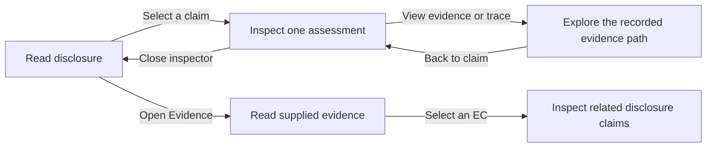

# BACE Interaction Design v2

Date: 2026-10-22

Current product direction: [BACE Evidence Explorer: Product Baseline](bace_product_baseline.md), dated 2026-10-23, defines the authoritative target, development principles, and acceptance criteria. This document remains historical.

Status: Historical design recommendation following author feedback and public-source design research. The author's subsequent four-column sketch supersedes this document's default layout. The implemented [interactive evidence explorer](../../prototypes/bace-explorer/README.md) now uses bidirectional tracing between disclosure, DCs, ECs, and source evidence, with diagnosis in a contextual bottom inspector. The [v2 storyboard](bace_storyboard_v2.md) remains a record of the earlier static concepts. This is not a usability test or a captured audit of the reference products.

## Decision

Use a document-centered default with an on-demand claim inspector and a separate trace view. Replace the always-visible Source Reader / Claim Explorer / Assessment layout proposed in [v1](bace_interaction_design.md).

The author reported that the initial concepts were not user-friendly, contained too much information, and were tiring to read. Treat this as direct feedback on those concepts, not as a population-level usability finding.

The design goal remains unchanged: trace disclosure text into DCs, supplied evidence into ECs, candidate membership, accepted support sets, and unsupported diagnosis. Change when each layer becomes visible.

## What likely made the previous concepts tiring

These are design hypotheses grounded in the proposed layout and the author's feedback:

- Three simultaneous reading regions competed for attention and required repeated horizontal scanning.
- Source wording, canonical claim wording, and the selected claim appeared in adjacent regions, sometimes repeating substantially the same content.
- The permanent claim inventory exposed IDs and categories before a reader needed them.
- A process strip, view navigation, status labels, set groups, and source controls competed for hierarchy.
- Long text in narrow columns produced frequent line breaks and made comparisons harder.
- The user had to choose a pane and an interpretation strategy immediately, before understanding the disclosure.

Reducing the number of simultaneously visible reading regions takes priority over color or decorative changes. A smaller font is not a density solution.

## Reference research

Access date for all sources: 2026-10-22. Sources were opened through web search. This research uses public design explanations and published examples, not authenticated interaction testing. Some full-resolution reference images could not be opened with the available web tool. No pixel measurements or accessibility compliance claims are made about those products.

The selected references are relevant functional examples, not an independently ranked list of the best interfaces.

| Reference and version | Original-source locator and evidence | Transfer to BACE | Limit |
| --- | --- | --- | --- |
| [Linear: A calmer interface for a product in motion](https://linear.app/now/behind-the-latest-design-refresh), 2026-03-12 | Sections “Don't compete for attention you haven't earned” and “Structure should be felt not seen”; the team describes reduced navigation prominence, fewer icon treatments, and softer separators. | Make the disclosure or selected assessment the visual focus. Recede case metadata and navigation; remove decorative status boxes and repeated dividers. | Linear is a dense work-management product. Its complete sidebar and navigation architecture are not the BACE template. |
| [Readwise Reader: Navigation](https://docs.readwise.io/reader/docs/faqs/navigation), live documentation | “How do I change my settings to keep the sidebars hidden at all times?” describes default side-panel visibility preferences. | Start with readable content. Open contextual details when requested and preserve document position when they close. | Hiding controls does not by itself prove easier use. Essential actions must remain discoverable. |
| [Readwise Reader: Long-form reading](https://docs.readwise.io/reader/guides/workflows/longform-reading), live guide | “Long-form reading view” describes removing the action-heavy bottom bar and prioritizing reading controls. | Separate reading from detailed inspection rather than displaying the complete toolset continuously. | The illustrated long-form changes include mobile controls; do not copy mobile geometry into a desktop research tool. |
| [Notion: Database side peek](https://www.notion.com/releases/2022-07-20), release dated 2022-07-20 | “Open database pages as side peek, center peek or full page” describes opening details on the right while the original database remains visible and interactive. | Let claim details appear beside their disclosure context, with an explicit close action and return position. | Do not inherit Notion's full properties table. The BACE inspector is about one assessment. |
| [iA Writer: Quick Tour](https://ia.net/writer/how-to/quick-tour), live guide | “Write in the Editor” describes hiding Library and Preview to leave the editor as the main surface. | Give text the main surface; make auxiliary panels optional. | Writing and evidence assessment differ. BACE must preserve visible routes to evidence and outcomes. |
| [iA Writer: Focus Mode](https://ia.net/writer/support/editor/focus-mode), live documentation | “Jumping Screen When Editing?” warns that focus-centering can conflict with selection and cause vertical jumping. | Do not automatically recenter the document on every selection. Highlight the current claim without making surrounding context unreadable. | Do not copy sentence dimming or typewriter scrolling as default review behavior. |
| [Nielsen Norman Group: Progressive Disclosure](https://www.nngroup.com/articles/progressive-disclosure/), 2006-12-03 | “Usability Criteria for Progressive Disclosure” distinguishes primary and secondary features and requires obvious, clearly labeled routes to more detail. | Keep the common assessment question visible; make the full processing record available through explicit controls. | This is design guidance, not evidence that the proposed BACE revision has been validated. |

## Revised interaction model

Read, inspect, and trace are progressive interface states, not a mandatory wizard. A researcher can open the trace directly and return without losing context.

## State A: Read disclosure

Show a compact case header, the generated disclosure, a small outcome summary, and one main review action. Do not open any claim automatically on initial load.

Visible controls:

- `Disclosure` and `Evidence` switch the main source being explored.
- `All claims` makes extraction boundaries and the claim inventory discoverable.
- `Review unsupported` selects the first unsupported DC and opens its inspector.
- `View process` opens the case-level processing overview without forcing a claim selection.

These are lightweight text controls and one primary button, not four competing filled buttons. Run identity and completeness remain available in the case header. Do not add headline metrics, charts, and a process ribbon to the main reading area.

Show restrained claim markers in the text margin. On hover or keyboard focus, reveal a short outcome label; clicking or pressing Enter opens the inspector. Hover must not be necessary to discover or activate the interaction.

For overlapping source spans, a marker can identify that a passage contains multiple claims. Selecting it reveals a short choice list. Do not give a whole sentence one outcome when its component claims differ.

`All claims` temporarily opens a searchable claim navigator or switches the reading surface to its claim view. It does not add a permanent third reading column. A claim with no reliable source match must remain reachable here.

## State B: Inspect one assessment

Opening a claim shows one inspector beside the disclosure. Preserve the selected passage and reading position. The inspector begins with the complete canonical claim, a clearly labeled BACE outcome, and the most relevant recorded content for that outcome.

### Supported DC

- Display `Supported · Direct` or `Supported · Inferred`.
- Show one complete accepted support set and all its required member EC texts together.
- Label multiple members `Required together` and preserve an explicit AND relationship.
- If alternative accepted sets exist, show their count and a clearly labeled set selector. Use a direct set first when the DC-level outcome is direct; otherwise select an inferred set deterministically.
- Keep `All candidates` available as a secondary section, because accepted support membership is not the same as candidate membership.
- Do not add a prose support explanation or confidence score that was not saved.

### Unsupported DC

- Display `Unsupported` and the recorded primary diagnosis.
- Show the saved rationale before the evidence inventory. Do not silently rewrite it into a newly generated explanation.
- Display a clearly labeled candidate section; expand it when the selected candidate set is short. For a large set, show its count and a visible expansion control rather than an arbitrary “best evidence” ranking.
- State `No accepted support set` separately from candidate membership.
- If no candidates were selected, say so without assigning a diagnosis from the empty count alone.

Avoid labeling every unsupported result `Needs review` as a replacement for its actual outcome. Human review state, if added later, is separate.

The inspector has a close button and Previous / Next claim controls. `Escape` closes the inspector and returns focus to the original claim marker. Do not advance automatically or animate the source on every selection.

## State C: Explore evidence and trace

`View source` opens the supplied evidence and recorded source quote. For close comparison, use a dedicated two-column disclosure/evidence surface, replacing the inspector rather than adding a third permanent column.

`View trace` expands the selected DC's processing history and related evidence. At first, show stage names and a concise summary. Expand a stage to inspect its records. Keep complete candidate membership and accepted set structure available.

The trace includes:

- source passage and extraction occurrences;
- canonical DC and any recorded merges;
- candidate ECs and their supplied evidence sources;
- accepted support sets, or the explicit empty result;
- unsupported diagnosis and rationale when applicable.

Use clear stage sections and a local relationship diagram. Do not require panning around a large graph to read one source quote. The full case overview remains accessible from `View process`.

Preserve the AND structure within each accepted support set and the alternative relationship between sets. Candidate-only ECs must not acquire a supporting edge through visual simplification.

## Evidence entry and reverse exploration

The `Evidence` entry shows supplied evidence cards as a readable list, with a selected card opening into the same document-centered surface. Selecting a source marker reveals its ECs; selecting an EC shows the DCs for which it was a candidate and the accepted sets containing it.

This preserves the original request to see what evidence became, including ECs never selected as candidates. Do not make reverse exploration dependent on finding a supported DC first.

## Proposed visual specifications

These are initial design settings to validate, not measured reference-product dimensions or completed accessibility checks.

| Element | Starting specification |
| --- | --- |
| Main disclosure text | 18 px, approximately 1.65 line height; roughly 60–75 characters per line |
| Assessment text | 16 px with comfortable paragraph spacing; avoid squeezing full claims into narrow cards |
| Reading column | Approximately 680–760 px wide on a wide desktop; cap line length rather than stretching to fill the screen |
| Inspector | Approximately 380–460 px on a sufficiently wide desktop; use a separate view at widths where two readable columns do not fit |
| Color | Near-white background, dark text, one restrained selection accent; outcome colors limited to small labeled marks |
| Separation | Space and alignment first; at most one main inspector divider; no nested card stacks |
| Metadata | Lower visual weight while retaining readable contrast; identifiers and raw records belong in trace details |
| Motion | Preserve scroll position; brief optional transitions; respect reduced-motion preferences |

Do not use ultra-light gray body text to achieve a calm appearance. Context must remain readable when a claim is selected. Do not borrow the reference products' dark themes as a presumed cure for fatigue.

## Semantic and data safeguards

The data joins and support semantics established in v1 remain applicable. Simplifying presentation must preserve:

- every DC and EC, including unlocated claims and unused ECs;
- all recorded source occurrences and available lineage;
- per-DC candidate membership;
- complete required-together support sets and alternatives;
- exact support and diagnosis categories;
- explicit missing, failed, pending, and unsupported states;
- scope and denominators for any displayed counts or rates;
- the distinction between original source text and claim text supplied to a judge.

Do not infer evaluator attention, per-candidate rejection reasons, or confidence from the available artifacts. Keep automated judgments distinct from human validation.

## Next design artifact

Produce one coherent design direction with three sequential states: Read disclosure, Inspect a supported claim requiring multiple ECs, and Inspect an unsupported claim with candidate evidence. Show the trace as an additional expanded state if required to evaluate that interaction.

This changes the purpose of the next comparison: evaluate whether the interaction becomes understandable as detail opens, rather than compare small stylistic variants of the same dense layout.

Reuse clearly marked illustrative data for visual concepts. If actual saved cases are used locally for implementation checks, preserve their IDs and provenance and do not upload them to a design service without authorization.

## Proposed evaluation tasks

- From initial load, identify where to read and how to inspect a claim.
- Open an unsupported DC and find its recorded explanation without scanning an unrelated claim list.
- Identify every EC required for a supported DC; do not mistake a member for independently sufficient evidence.
- Find all candidates and the original supplied source without losing disclosure context.
- Find the complete extraction inventory and reverse-trace an EC never used for support.
- Close details and resume reading at the same passage.
- Distinguish unassessed claims from explicitly unsupported claims.

Compare task completion and interpretation errors across the original and revised layouts with the same fixtures. No improvement percentage is asserted before testing.
