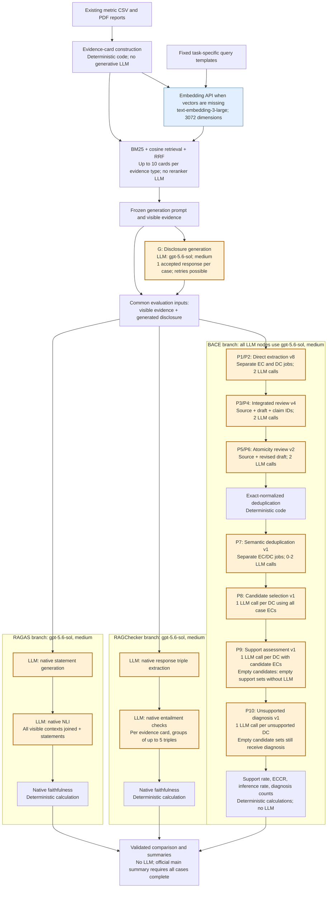

# BACE main experiment: execution and prompt map

Inspection date: 2026-10-26. This map follows `BACE/script/pipeline.py`, the preparation and evaluation implementations, their configurations, and all saved call records for the twelve **Genmab 2019** main-run tasks. It does not certify every call in the 1,800-case main experiment or establish evaluator accuracy. The previously inspected run status records 1,798 completed cases and two failures; this document does not mark the main run complete.

All generative stages are configured as **Azure OpenAI `gpt-5.6-sol`, medium reasoning**. The twelve inspected cases agree with that configuration. The configuration records model version `2026-07-09`; this is not an independently established immutable provider revision. Saved provider responses may return a deployment name rather than a separate base-model version.

The embedding model is **`text-embedding-3-large`, 3072 dimensions**. Embedding is a separate API operation, not a generative prompt call. Prepared document/query vectors are reused where compatible. Main execution consumes frozen retrieval and generation inputs.

The flowchart source is [flow.mmd](flow.mmd). Orange nodes call an LLM; blue denotes embedding. EC and DC jobs remain separate within extraction, review, and deduplication. BACE, RAGChecker, and RAGAS execute as parallel branches after generation.



## Inputs, outputs, and call granularity

| Stage | Model input | Output | Logical LLM jobs per case, excluding retries |
|---|---|---|---|
| Evidence construction | Existing source CSV and PDFs | Narrative, PDF-table-row and CSV-metric cards with provenance | None in this preparation stage; upstream production of the existing metric CSV is outside this map |
| Embedding and retrieval | Card text; fixed task query bundles | Vectors, ranked/selected evidence, frozen generation inputs | Embedding API as needed; BM25, cosine ranking and RRF use code |
| G: Generation | Complete frozen `generation_prompt`: instruction, source labels and visible evidence text | One accepted 300-500-word disclosure | One accepted response; rejected outputs, network retries and stage retries can add requests |
| P1/P2: Direct extraction | EC: entire visible evidence section plus context. DC: entire generated disclosure plus context | EC/DC occurrence drafts with source quotations and uncertainty fields | One EC job and one DC job; not one job per card |
| P3/P4: Integrated review | Same permitted source and context, preceding draft, immutable claim index | Identified edits/additions/exclusion changes; code applies edits to create revised drafts | One EC job and one DC job |
| P5/P6: Atomicity review | Source/context, integrated draft and claim index | Conservative split edits; code constructs revised occurrence inventories | One EC job and one DC job |
| Exact deduplication | Occurrence claim texts | Units grouped by Unicode NFKC, casefold and whitespace normalization | None |
| P7: Semantic deduplication | Entire exact-normalized unit set for one case and kind; unit IDs and claim text | Equivalence partition and an existing canonical member per group; code retains provenance | One EC job and one DC job if each has more than one unit; singleton jobs bypass the LLM. Empty inputs are errors |
| P8: Candidate selection | One DC plus the complete deduplicated EC set for that case; temporary IDs and claim text | Candidate EC IDs | One per DC |
| P9: Support assessment | One DC, its selected candidate ECs, company/year context | Minimal sufficient support sets tagged `direct` or `inferred` | One per DC with candidates. Empty candidates produce an empty support-set list without an LLM |
| P10: Unsupported diagnosis | One unsupported DC, its candidate ECs, company/year context | One primary unsupported label and one-sentence rationale | One per unsupported DC, including those with zero candidates |
| Metrics | Final EC/DC inventories, support sets, diagnoses and candidate records | All-DC support rate, ECCR, inference rate and diagnostic counts | None |

The support stage returns support sets, not a prose explanation or a separate numerical score. Code derives the DC category: any direct set means direct support; only inferred sets means inferred support; no sets means unsupported. Diagnosis consumes only the unsupported subset and does not revise support sets. The diagnosis LLM receives the DC and candidate ECs, not the prior support-response payload.

Integrated review checks admission, coverage, fidelity, context and atomicity jointly. The following atomicity pass has a narrower contract: split existing compound assertions while retaining their meaning. It cannot freely add missing claims, delete claims, merge different parents or change exclusions. Both passes are model-based, not completed human validation.

## Prompt files

Twelve ESG tasks share each stage's template(s). The task-specific evidence, disclosure and claim inventories supply the changing input. These are eleven BACE/generation template files: one generation JSON template and ten evaluation text prompts. JSON response schemas also constrain every BACE extraction/evaluation response; their exact paths are in `saved_flow_inventory.json`.

| ID | Stage | Active source file |
|---|---|---|
| G | Generation | [generation_prompt_templates.json](/home/muwang/master_thesis/BACE/config/prompts/generation_prompt_templates.json) |
| P1 | Direct EC | [generation_ec_claim_extraction_prompt_v8.txt](/home/muwang/master_thesis/BACE/config/evaluation/prompts/generation_ec_claim_extraction_prompt_v8.txt) |
| P2 | Direct DC | [generation_dc_claim_extraction_prompt_v8.txt](/home/muwang/master_thesis/BACE/config/evaluation/prompts/generation_dc_claim_extraction_prompt_v8.txt) |
| P3 | Integrated EC | [generation_ec_claim_patch_review_prompt_v4.txt](/home/muwang/master_thesis/BACE/config/evaluation/prompts/generation_ec_claim_patch_review_prompt_v4.txt) |
| P4 | Integrated DC | [generation_dc_claim_patch_review_prompt_v4.txt](/home/muwang/master_thesis/BACE/config/evaluation/prompts/generation_dc_claim_patch_review_prompt_v4.txt) |
| P5 | Atomicity EC | [generation_ec_claim_atomicity_review_prompt_v2.txt](/home/muwang/master_thesis/BACE/config/evaluation/prompts/generation_ec_claim_atomicity_review_prompt_v2.txt) |
| P6 | Atomicity DC | [generation_dc_claim_atomicity_review_prompt_v2.txt](/home/muwang/master_thesis/BACE/config/evaluation/prompts/generation_dc_claim_atomicity_review_prompt_v2.txt) |
| P7 | Semantic deduplication | [generation_claim_semantic_dedup_prompt_v1.txt](/home/muwang/master_thesis/BACE/config/evaluation/prompts/generation_claim_semantic_dedup_prompt_v1.txt) |
| P8 | Candidate selection | [generation_claim_candidate_selection_prompt_v1.txt](/home/muwang/master_thesis/BACE/config/evaluation/prompts/generation_claim_candidate_selection_prompt_v1.txt) |
| P9 | Support assessment | [generation_claim_support_prompt_v1.txt](/home/muwang/master_thesis/BACE/config/evaluation/prompts/generation_claim_support_prompt_v1.txt) |
| P10 | Unsupported diagnosis | [generation_claim_unsupported_diagnosis_prompt_v1.txt](/home/muwang/master_thesis/BACE/config/evaluation/prompts/generation_claim_unsupported_diagnosis_prompt_v1.txt) |

[generation_claim_definition_v2.txt](/home/muwang/master_thesis/BACE/config/evaluation/prompts/generation_claim_definition_v2.txt) is already included at the beginning of the integrated/atomicity system prompts. It is not an additional LLM stage.

Generation sends the complete frozen prompt as its model input. BACE extraction/evaluation sends a system instruction plus a JSON user message, with a strict structured-output schema. Saved `dynamic_input` fields identify the actual user content. Deduplication can append a correction instruction after a partition-validation failure; later attempts therefore need not have the same message hash as the initial request.

## Recorded deployment routing

| Stage | Configured model | Saved Azure deployment |
|---|---|---|
| Generation | gpt-5.6-sol | gpt-5.6-sol-generation |
| Direct, integrated, atomic | gpt-5.6-sol | gpt-5.6-sol-claim-extraction |
| Semantic deduplication | gpt-5.6-sol | gpt-5.6-sol-semantic-dedup |
| Candidate selection | gpt-5.6-sol | gpt-5.6-sol-claim-candidate |
| Support assessment | gpt-5.6-sol | gpt-5.6-sol-support-assessment |
| Unsupported diagnosis | gpt-5.6-sol | gpt-5.6-sol-claim-diagnosis |
| RAGChecker and RAGAS | gpt-5.6-sol | gpt-5.6-sol-support-assessment |

All inspected generative call records use medium reasoning. Deployment names are routing identities, not distinct independently verified base-model families. These observations are scoped to the twelve inspected cases.

## External comparators

RAGChecker and RAGAS receive the same prompt-visible evidence and generated disclosure through the checked common adapter. They do not consume BACE's EC/DC inventory or its support decisions.

| Framework | Native model stages | Prompt source |
|---|---|---|
| RAGChecker 0.1.9 / RefChecker 0.2.13 | Response triple extraction; entailment checking against individual evidence cards, groups of up to five triples; deterministic faithfulness | `LLM_TRIPLET_EXTRACTION_PROMPT_Q` in [extractor_prompts.py](/home/muwang/master_thesis/BACE/.venv/lib/python3.11/site-packages/refchecker/extractor/extractor_prompts.py:178); `JOINT_CHECKING_PROMPT_Q` in [checker_prompts.py](/home/muwang/master_thesis/BACE/.venv/lib/python3.11/site-packages/refchecker/checker/checker_prompts.py:1) |
| RAGAS 0.4.3 | Statement generation; NLI over the joined visible contexts and all statements; deterministic faithfulness | `StatementGeneratorPrompt` and `NLIStatementPrompt` in [util.py](/home/muwang/master_thesis/BACE/.venv/lib/python3.11/site-packages/ragas/metrics/collections/faithfulness/util.py:27) |

The exact assembled native prompts are saved in each framework's `calls.jsonl`, field `prompt`. RAGAS's class definitions include examples and schemas in addition to their instruction. Both comparators use the shared support deployment with Azure Responses transport. Normal RAGAS execution has two logical LLM jobs per case. RAGChecker checking call counts depend on its native claim count and the evidence-card count; resume/cache behavior and retries affect request counts.

## Concrete saved example: Genmab 2019, E1-1

| Stage | Successful model records | Deterministic bypass records |
|---|---:|---:|
| Generation | 1 | 0 |
| Direct EC/DC | 2 | 0 |
| Integrated EC/DC | 2 | 0 |
| Atomicity EC/DC | 2 | 0 |
| Semantic deduplication EC/DC | 2 | 0 |
| Candidate selection | 45 | 0 |
| Support assessment | 42 | 3 |
| Unsupported diagnosis | 29 | 0 |
| RAGChecker extraction | 1 | 0 |
| RAGChecker checking | 210 | 0 |
| RAGAS statement generation | 1 | 0 |
| RAGAS NLI | 1 | 0 |

These are counts of saved successful records, not a reconstruction of all provider requests or billed calls. The other eleven task examples are in [call_counts.csv](call_counts.csv). The support-stage bypass illustrates why a saved result record does not always mean that a model was called.

For a nonempty valid BACE case, define D as deduplicated DC count, D+ as DCs with nonempty candidate sets, U as unsupported DC count, and K as the number of EC/DC semantic-dedup jobs requiring a model (0-2). The normal logical-job count, including generation but excluding comparators/retries, is `1 + 6 + K + D + D+ + U`. Whole-evidence EC extraction/review and whole-disclosure DC extraction/review account for the six fixed jobs.

## Saved evidence and reproduction

- [saved_flow_inventory.json](saved_flow_inventory.json): model/deployment sets, active prompt/schema paths, verification counts, per-task stage counts and explicit scope.
- [input_manifest.json](input_manifest.json): absolute source paths, file sizes and SHA-256 identities.
- [inspect_saved_flow.py](inspect_saved_flow.py): standard-library-only read audit; writes only this directory. It neither imports experiment modules nor loads credentials or makes model calls.

The audit matches all 1,789 inspected BACE call-record prompt hashes to their active template, reconstructs and matches 1,748 initial BACE message hashes, and matches 2,899 native-comparator prompt hashes. Deterministic bypass records have no model message hash. It validates the initial message of a retried job rather than every later retry payload. Generation prompt hashes are checked separately for the twelve examples. These checks establish identity, not the scientific correctness of a prompt or output.

```bash
python3 -B /home/muwang/master_thesis/paper/analysis/bace_pipeline_map_2026-10-26/inspect_saved_flow.py
less /home/muwang/master_thesis/paper/analysis/bace_pipeline_map_2026-10-26/README.md
```
