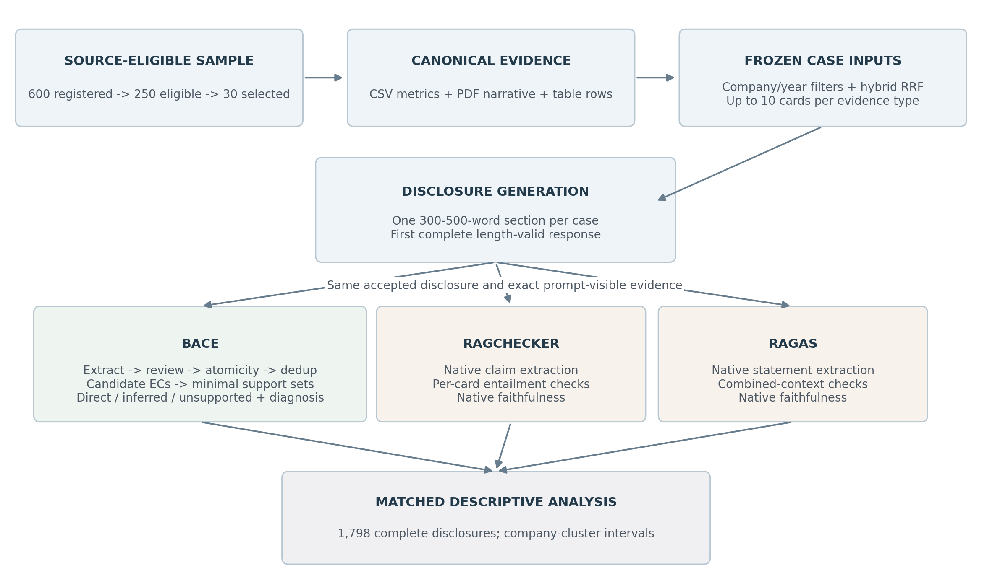
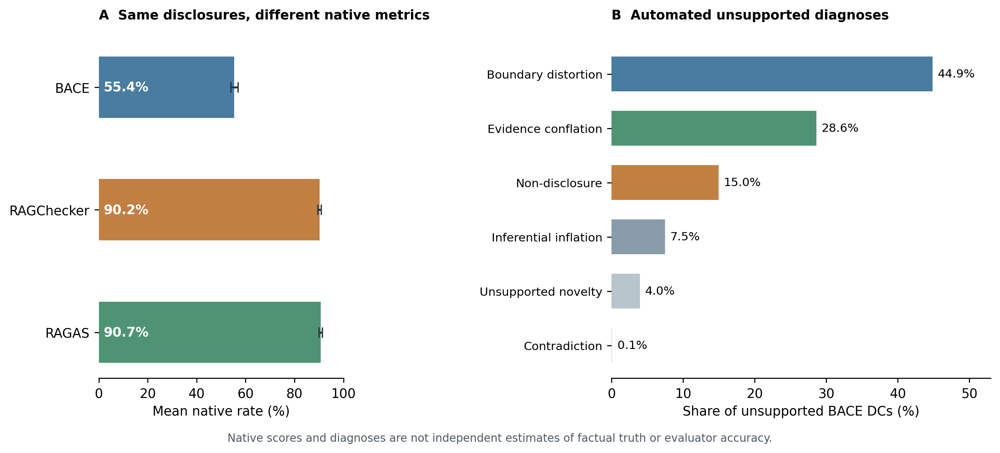

# BACE Main Experiment: End-to-End Workflow and Principal Results

**Evidence status:** checked against saved local artifacts on 2 November 2026. **Experiment:** `bace_30x5x12_v1`, saved run `main_v1`. **Purpose:** an internal technical report, not a new experiment, a preregistration or an independent validation study.

## Executive summary

BACE, or Bidirectional Atomic Claim Evaluation, evaluates whether a generated corporate sustainability disclosure is supported by the evidence actually supplied to its generator. The main experiment combines a source-availability-based company sample, deterministic preparation of heterogeneous evidence cards, a frozen hybrid retrieval workflow, one disclosure-generation configuration and three automated evaluation procedures.

The planned design comprises **30 companies, five reporting years and 12 disclosure tasks**, or **1,800 generated disclosures**. Generation and both native comparator branches completed for all 1,800 cases. BACE completed for **1,798**, which form the common cohort used throughout the principal results. The two remaining BACE cases are not assigned zero scores or silently counted as complete.

On that common cohort, the mean disclosure-level BACE support rate is **55.4%**, compared with native faithfulness scores of **90.2% for RAGChecker** and **90.7% for RAGAS**. These are different automated measurements, not an evaluator-accuracy ranking. BACE labels 44.9% of its pooled disclosure claims unsupported; 73.5% of those diagnoses are factual boundary distortion or evidence conflation. [S1, S11-S14]

## 1. Study objective and experimental units

The study asks a bounded question: **when a model writes an ESRS-style disclosure from a fixed set of corporate reporting evidence, which claims are supported by that supplied evidence, how is support established, and where does support fail?** It does not ask whether the companies are sustainable, whether their original reports are correct, or whether the generated sections legally comply with ESRS.

A **case** is one company, target reporting year and disclosure task. Each case has its own selected evidence, generation prompt, generated disclosure and evaluation outputs. A **company-year** contains 12 cases, and a company contributes five company-years. Consequently, disclosures, tasks, years and claims must not be treated as independent sampled companies. The design includes 150 company-years and 30 company clusters.

The historical years specify simulated reporting tasks. The generated texts are not observations of actual AI adoption in 2019-2023, and applying the 2023 ESRS task definitions retrospectively does not establish historical legal obligations. This report describes the completed records of one retrieval/generation configuration, not a cross-model benchmark or an intervention demonstrating improved reporting outcomes. [S1, S2, S14]

### End-to-end flow

**Figure 1.** Source preparation and retrieval occur before the main run. The same frozen visible evidence and accepted generated disclosure feed all three evaluation branches. BACE then applies its own claim-construction and support-assessment pipeline. This diagram depicts dependencies, not a claim of independently validated correctness.

## 2. Dataset and company selection

### 2.1 Data origin and files actually used

The local corpus is organized as the **Corporate Sustainability Tracker** dataset. Its upstream repository describes extracting ESG indicators from corporate annual and sustainability reports through a separate RAG pipeline and subsequently standardizing units, including currency conversion where applicable. The present BACE experiment starts from the already-processed metric CSV and the locally available report PDFs; it does **not** rerun that upstream indicator-extraction pipeline. The upstream README was inspected at commit `3d8ccb1d0f0e6f212924b372f2da8510ee457d3b`. This establishes the documented source lineage, not byte-level identity between every local file and the currently distributed remote dataset. [S0, S3, S4]

| Local source | Role in the BACE experiment |
| --- | --- |
| `data/raw/datasets/companies.csv` | Company identifiers, names, countries and year-specific SICS classifications; the register has 600 distinct companies. |
| `data/processed/results/esg_indicators_postprocessed.csv` | Existing model-extracted and postprocessed indicator records, including company, year, indicator ID, validity flag, final value and final unit. |
| `data/raw/datasets/indicator_metadata.csv` | Indicator descriptions and their ESG/ESRS metadata, merged into metric cards. |
| `data/raw/reports_pdf/` | Local annual and sustainability reports used to extract narrative and table evidence. |
| `BACE/evidence/sample/` | Frozen sampling frame, selected companies, quotas, seed, reserve order and source hashes. |

The upstream extraction and BACE card preparation are different operations. A source row marked `model_output_valid` is eligible for deterministic rendering; that flag does **not** certify that the extracted metric faithfully represents its original PDF. Original-source errors can therefore propagate into generated disclosures and into apparently supported claims. External ESG ratings and financial databases described as optional in the upstream repository are not required inputs to the frozen BACE workflow. [S0, S3, S4]

### 2.2 Source-availability screening

A company is eligible when its latest recorded primary SICS sector at or before 2023 is known, it has at least one valid nonempty metric in **every source year 2015-2023**, and it has at least one local file with a PDF header in **every source year 2015-2022**. Full parsing subsequently verifies annual narrative availability. These rules yield **250 eligible companies from the 600-company register**.

The screening does not require every ESRS task to have a corresponding metric, and it does not select on favorable content or evaluator scores. Its purpose is to provide the complete rolling source windows needed for all target years. Nevertheless, it restricts inference to a complete-source subpopulation. Neither the 30-company sample nor the results are automatically representative of all 600 companies. Missing metrics are not imputed. [S1, S3]

### 2.3 Stratified sample

One company is allocated to each of the 11 eligible SICS sectors. The remaining 19 places are allocated by Hamilton largest remainders, proportional to eligible sector counts minus one, with alphabetical tie-breaking. Within each sector, sorted company IDs are shuffled using Python `random.Random` and the integer SHA-256 digest of `20260916:<sector>` as the sector-specific seed. The first companies fill the quota; the remainder form an ordered reserve. [S1, S3]

| SICS sector | Eligible companies | Selected companies |
| --- | --- | --- |
| Consumer Goods | 23 | 3 |
| Extractives & Minerals Processing | 12 | 2 |
| Financials | 48 | 5 |
| Food & Beverage | 18 | 2 |
| Health Care | 19 | 2 |
| Infrastructure | 26 | 3 |
| Renewable Resources & Alternative Energy | 2 | 1 |
| Resource Transformation | 48 | 5 |
| Services | 18 | 2 |
| Technology & Communications | 23 | 3 |
| Transportation | 13 | 2 |

Replacement is permitted only when a required source year proves wholly unusable before generation, using the next prespecified same-sector reserve. An unfavorable generation or evaluation outcome cannot trigger replacement. No replacement is recorded for this draw. Countries are retained as register metadata, not used to allocate the sample. The complete selected-company list is in Appendix A. [S1, S3]

## 3. Data processing and evidence preparation

### 3.1 Three source-centric evidence-card types

The selected corpus contains **401 PDF reports**. BACE transforms the inputs into three permanent, source-centric card types. The final retained canonical inventory is:

| Retained canonical evidence type | Distinct cards | Preparation |
| --- | --- | --- |
| CSV metric | 43,827 | Deterministic rendering of valid, nonempty extracted rows |
| PDF narrative | 497,551 | PyMuPDF narrative extraction and chunking |
| PDF table row | 390,070 | pdfplumber table detection and row serialization |
| Total | 931,448 | All indexed using the same embedding identity |

**CSV metric cards.** The preparation code selects the sampled companies and source years 2015-2023, retains rows with a true validity flag and nonempty `value_final`, and merges indicator metadata. It renders the company, source reporting year, ESG topic, ESRS standard, disclosure requirement, indicator description, value and unit through a deterministic text template. Each card keeps the original extracted value, unit, stable indicator key and CSV hash. The identifier follows `csv::<company_id>::<year>::<data_point_id>`. No LLM is used to construct these cards, and BACE does not invent missing values or restandardize their units. [S4]

**PDF narrative cards.** PyMuPDF supplies cleaned narrative text. The frozen extraction configuration uses the recorded **40-250-word chunking rules**, a 50-character minimum and no inclusion of short narrative fragments. Whole eligible reports are processed; task keywords or evaluator scores do not select pages. This describes the extraction rules, not a guarantee that every resulting chunk perfectly respects sentence or table boundaries. [S4, S5]

**PDF table-row cards.** pdfplumber detects tables, and each extracted row is serialized as deterministic retrieval text with the available table structure. Table markdown is excluded. Flattening a table or glossary into text can lose heading-to-cell or row-to-description relationships; the original PDF remains necessary to assess such ambiguity. [S4, S5]

All card types retain stable evidence IDs, company and source-year metadata, source paths and hashes. PDF cards also retain page locations. CSV provenance points to the processed record and metric key, not to a falsely asserted verbatim quotation from the original report. A canonical card can appear in several rolling packages or several tasks without becoming several distinct source cards.

An **evidence card** is a source-text unit prepared for retrieval, not an atomic factual claim. A **canonical card** is the permanent source-centric record; a **visible card occurrence** is one inclusion of that card in a particular generation prompt. BACE later extracts potentially several ECs from a visible card and consolidates equivalent EC occurrences within the case. Thus card counts, visible occurrences and deduplicated EC counts have different units and must not be substituted for one another. [S4, S8, S10]

### 3.2 Quality exclusions and their boundaries

Before generation, a uniform quality gate excludes an **entire card** if it contains at least ten unmapped private-use or replacement glyphs constituting more than 5% of non-whitespace characters, or more than 8,191 `cl100k_base` tokens. The gate records **44 excluded cards**; the build counts show 30 narrative and 14 table-row removals. The recorded reason for these exclusions is unmapped font glyphs. Unreadable extractions are not truncated or repaired by guessed character mappings. [S6]

Four additional **Evonik 2023 CSV mappings** are quarantined following source inspection: alleged corruption cases rendered as confirmed incidents; general-compliance dismissals and terminated relationships rendered as corruption incidents; and a payment-period proportion rendered as a mean payment period. They are excluded rather than assigned replacement values. These four metric exclusions are separate from the 44 PDF-card quality exclusions. The shared CSV remains unchanged, and the checks do not validate all remaining model-extracted records. [S4, S6]

The build also independently re-extracted 32 reused report-card sets from their current hashed PDFs and recorded matching IDs, texts, years and locations. This supports reuse integrity; it does not establish that the extractor interpreted every source layout correctly. Annual source availability is rechecked after exclusions. [S1, S4]

### 3.3 Rolling evidence windows

For target reporting year **t**, metric cards use source years **t-4 through t**, while PDF cards use report years **t-4 through t-1**. Each company-year package is defined before its tasks are retrieved.

| Target reporting year | Eligible CSV source years | Eligible PDF report years |
| --- | --- | --- |
| 2019 | 2015-2019 | 2015-2018 |
| 2020 | 2016-2020 | 2016-2019 |
| 2021 | 2017-2021 | 2017-2020 |
| 2022 | 2018-2022 | 2018-2021 |
| 2023 | 2019-2023 | 2019-2022 |

These are **source/report-year filters**, not verified publication-date cutoffs. A report can contain earlier measurements and future commitments, and those qualifications must remain attached to the factual proposition. Current-year structured metrics and lagged PDF narratives therefore have different information boundaries. Generated text from another case is never added to the evidence. [S1, S4]

## 4. Task specification, retrieval and generation

### 4.1 Twelve ESRS-style disclosure tasks

Every selected company receives every task in each target year. The tasks use the **2023 ESRS edition** consistently rather than silently mixing later revisions into the task IDs. [S1, S2]

| Topic family | Task | Requested disclosure content |
| --- | --- | --- |
| Climate, E1 | E1-1 | Transition plan for climate change mitigation |
| Climate, E1 | E1-3 | Actions and resources |
| Climate, E1 | E1-4 | Climate targets |
| Climate, E1 | E1-6 | Greenhouse gas emissions |
| Own workforce, S1 | S1-1 | Workforce policies |
| Own workforce, S1 | S1-4 | Workforce actions and resources |
| Own workforce, S1 | S1-5 | Workforce targets |
| Own workforce, S1 | S1-14 | Health and safety |
| Business conduct, G1 | G1-1 | Business conduct policies |
| Business conduct, G1 | G1-2 | Supplier relationships |
| Business conduct, G1 | G1-3 | Anti-corruption controls |
| Business conduct, G1 | G1-4 | Corruption and bribery incidents |

### 4.2 Frozen hybrid retrieval

Each task has an explicit, frozen multi-query bundle. Before scoring, retrieval restricts the corpus to the case's company, admissible source years and evidence types. BM25 provides lexical rankings; cosine similarity over normalized **3,072-dimensional `text-embedding-3-large` vectors** provides dense rankings. Each channel retrieves up to **200 candidates per subquery**. Two-level reciprocal rank fusion first combines subqueries within a channel and then combines the channels, using **k = 60**. Ties use best individual rank, most recent source year and evidence ID. [S7]

The final main-condition selection retains **up to ten cards from each evidence type**, for a maximum of 30. There is no reranker and no redistribution when one evidence type supplies fewer cards. The presentation order is PDF narrative, PDF table row, then CSV metric. The prompt exposes source labels and `Evidence 1`, `Evidence 2`, etc.; stable identifiers and retrieval scores are retained outside the generator-facing text.

The retained inventory contains **931,448 cards** indexed through an exact cosine matrix with an evidence-ID row mapping. Compatible vectors are reused only when their embedding-text hash and model/dimension/prefix identity match. The frozen source matrix is already normalized; retrieval normalizes query vectors without unnecessarily renormalizing corpus vectors. This is the executed main retrieval condition, not a comparison of all optional retrieval settings. [S7]

All 150 packages, 1,800 query bundles, selected evidence sequences and generation inputs are prepared **before** the main run. The saved prompts contain **51,806 card occurrences**, averaging **28.78 per case**, with **10-30** visible cards per case. Occurrences count repeated use across prompts; they are not a count of distinct canonical cards. The main run consumes these frozen inputs without new retrieval requests. [S7, S8, S13]

### 4.3 Disclosure generation and acceptance

The generator is the configured Azure OpenAI **`gpt-5.6-sol`** deployment, with recorded model-version label **`2026-07-09`**, **medium reasoning**, no temperature parameter, **8,192 maximum output tokens** and `store=false`. The shared instruction puts the model in the company's sustainability reporting team and asks for a **300-500-word** professional disclosure addressing the task and using only supplied evidence. It prioritizes task-relevant reported activities, policies, metrics, governance, methods, targets and developments. The same instruction template applies to all 12 tasks. [S2, S8]

Only `generated_text` is generated by the LLM; identifiers, hashes, counts, metadata and acceptance records are assembled by code. The first complete response within the length range is accepted. An incomplete or out-of-range response triggers up to two retries of the **identical prompt per invocation**; rejected texts are retained. The stage runner has its own maximum of three attempts. Acceptance is based on response completeness and length, **not BACE or comparator scores**. The recorded accepted disclosures span **317-468 words**. [S8, S9]

An **accepted disclosure** is therefore a response that passes this engineering contract, not a disclosure already judged factually supported. The generation instruction to use supplied evidence is a constraint on what the model should write; compliance with that instruction is assessed separately. Likewise, **ESRS-style** describes the requested topic and disclosure form, not a legal-compliance certification. [S1, S8]

Routing identities, requests, returned provider information where available, raw responses and rejection records are preserved. A frozen client-side model-version label does not guarantee that a later remote service produces an identical response. These records support auditability of the saved run, not deterministic reproduction of future model outputs.

### 4.4 Pilot, freeze and recovery

A prespecified engineering pilot contains one case per task, selected before generation and evaluation. It exercises the common pipeline, schema contracts, native comparator inputs and postprocessing. The scientific inputs and executable environment are frozen; stage receipts record commands, dependencies and output hashes, enabling verified completed stages to be reused after interruption. Failed stages cannot feed dependent stages. [S1, S9]

The main run is still recorded as **incomplete** because two BACE branches remain unresolved. The saved status timestamp is **18 September 2026, 10:42 UTC**; the report checks the current files on 2 November 2026 rather than suggesting that all 1,800 BACE cases have subsequently completed. Independent prompt-sensitivity and evidence-chain experiments elsewhere in the repository are **not** substituted for missing main-run cases or merged into the principal results.

## 5. Evaluation procedures

### 5.1 Common input boundary

Every evaluator starts from the accepted disclosure and the **exact evidence blocks shown to its generator**. The common adapter checks the prompt and response hashes, the ordered evidence labels, each card's text hash and the reconstructed context hash. No evaluator is given a reference disclosure, and reference-dependent metrics are not reported. The comparators do not receive BACE verdicts as inputs. However, common top-level inputs do not imply identical internal claim inventories or checking contexts. [S10, S11]

### 5.2 BACE claim construction

An **evidence claim (EC)** expresses a proposition extracted from supplied evidence; a **disclosure claim (DC)** expresses a proposition extracted from generated text. The operational definition v2 treats a **claim** as a substantive proposition asserted about an entity, action, state, measurement, intention, classification, absence or relationship. Claim admission does not depend on truth, eventual support, positivity or relevance to the requested task: false, unsupported, negative, uncertain, prospective and off-topic assertions are retained if they are substantive. BACE constructs both inventories through the following sequence. [S10; Appendix C]

| Stage | What it does | Important boundary |
| --- | --- | --- |
| Direct extraction v8 | Extracts EC occurrences from each visible card and DC occurrences from the disclosure. | Each initial EC is attributed to a single source card; material qualifiers must remain attached. |
| Identified-patch review v4 | Repairs admission, missing assertions, context, grammatical binding and atomicity against the source. | Replacements identify immutable claim IDs and exact expected old text; additions and addressed deletions are allowed, with edit lineage. |
| Constrained atomicity review v2 | Splits an existing compound assertion only when it contains independently assessable source assertions. | Each edit replaces one original claim with at least two complete children; no free additions, deletions, cross-parent merging or exclusion changes. |
| Semantic deduplication | Consolidates exact-normalized and semantically equivalent claims within a case. | Mutual entailment and the same truth conditions define semantic equivalence; source-occurrence lineage is retained. |

**Substantive admission versus `missing_proposition`.** A recoverable predicate or named metric is required. A company, year and bare number without an identifiable attribute are not made into a claim by writing that a table “records” the number. Bare titles, taxonomy labels, GRI navigation, processing notes and unrecoverable fragments belong in exclusions. A substantive achievement heading or an explicitly asserted classification can, however, be a claim. An actual assertion that a value was not disclosed or that data were unavailable is also admissible. A missing qualifier is different from a missing predicate: an identified emissions measurement with an unknown period remains a claim with that uncertainty; an unlabelled numerical cell without an identifiable metric does not. [S10; Appendix C]

**Atomicity.** An atomic claim contains one independently assessable assertion with all its governing arguments and qualifiers; it is not necessarily one short sentence. Separate independent predicates, explicitly identified measurements or years, and clearly distributive objects. Preserve joint targets, collective relationships, comparisons, causes and conditions with their full arguments. Do not create a Cartesian product of population modifiers or distribute a combined target percentage to each component. In the prompt's illustrative combined Scope 1/Scope 2 target, splitting must not turn the combined reduction into separate equal-percentage targets. Explicit underlying facts may be retained alongside an explicit relationship, but extraction must not calculate new values or invent consequences. These are prompt illustrations, not additional experimental observations. [S10; Appendix C]

**Self-contained meaning and material boundaries.** Each claim independently retains the applicable entity or subsidiary, actor, population, geography, activity scope, time, metric definition, value, unit, negation, modality and material conditions. Dependent target or plan claims retain the full known identity, including magnitude, scope, baseline and deadline. Source-report time, intended action time and measurement time are distinct: case metadata or a report year cannot silently fill a missing measurement date. “Plans to,” “can,” “approximately,” “at least” and an achieved outcome are not interchangeable. Sibling claims, quotations or notes cannot substitute for context required in `claim_text`. [S10; Appendix C]

**Source roles and unresolved context.** EC extraction can consult the complete visible evidence to resolve explicit antecedents or headings, but each EC must be asserted by its assigned card; a similar card cannot supply a missing value or header. DC extraction uses the complete generated disclosure, its headings and antecedents, not retrieved evidence or a reference answer that could correct its errors. Genuinely ambiguous expressions retain their original breadth or unresolved referent plus an `unresolved_context` note, rather than a guessed reading. DC `context_resolutions` records any actual use of supplied metadata through its surface form, metadata field and resolved value; metadata does not create absent facts. `source_quotes` locate the supplied assertion and context. [S10; Appendix C]

**Deduplication and the counted unit.** Exact normalization uses Unicode NFKC, case folding and whitespace normalization. Semantic equivalence means **mutual entailment with the same truth conditions**: every pair within a group must express the same proposition at the same material boundaries. Topic similarity, one-way entailment, a conjunction and one of its components, or similarity chaining are insufficient. Ambiguous equivalence remains a singleton. The canonical text is an existing member selected for clear, self-contained meaning, not a newly generated paraphrase. Each original occurrence is assigned once and retains its source lineage; the final deduplicated DC, not each repeated mention, is the scoring unit. Semantic-dedup input is capped at 400 exact-normalized units per case and kind. [S10; Appendix C]

The BACE stage configurations use the same configured model family and medium-reasoning setting as described above. The extraction acceptance mode is **schema-only**: a stored quote is not automatically required to be an exact source substring, although the prompt asks for faithful quotations. A valid schema, stable ID or retained quotation field therefore does not independently establish extraction fidelity. The definitions above specify intended behavior, not independently verified perfection of every extracted claim.

### 5.3 Candidate EC selection

For each deduplicated DC, an LLM receives the DC text and the complete deduplicated EC texts for that case. It selects **all materially relevant ECs**, including potentially supporting, partially supporting, contradictory or boundary-mismatched claims. This is recall-oriented semantic candidate selection, **not the earlier document-card retrieval stage** and not a fixed top-k support search.

**Material relevance** includes an EC that supports all or part of the DC, supplies a necessary premise for joint support, describes the same core fact at different boundaries, contradicts the DC, or provides an anchor for diagnosing its unsupported content. A **recognizable evidential anchor** connects evidence to the DC's core factual proposition; shared keywords or a general sustainability topic alone are not enough. Recognizable relations among ECs can justify including a possible premise; they do not establish entailment at this stage. [S10; Appendix C]

The selection prompt imposes no fixed candidate count and includes uncertain material relevance rather than discarding it. Candidate membership is **not** a support verdict. The model sees claim texts and opaque temporary identifiers, not source provenance, original documents or task metadata as additional factual evidence. The configuration allows at most 500 ECs per case, while support and diagnosis configurations each allow at most 500 candidate ECs per DC. These are capacity limits, not instructions to retrieve the best 500 claims or force a particular candidate count. Missing candidates can prevent later recognition of valid support. [S10; Appendix C]

### 5.4 Minimal sufficient support sets

The support judge receives one DC, its selected candidate ECs, and company/target-year context. It does **not** receive the original cards or unselected ECs at this stage. Company and year contextualize meaning; they cannot supply absent facts. The judge does not assess whether the ECs themselves are true. [S10; Appendix C]

**Support and entailment.** Support requires that one EC or a combination of ECs establishes the **complete factual meaning** of the DC, preserving quantification, semantic scope and all material qualifiers. Relevance, resemblance, compatibility and partial support are insufficient. Evidence about a limited population does not support an all-population assertion unless that broader scope is entailed. An EC's uncertainty or intention must not become certainty or achievement in the DC. Thus “supported” means supported within the supplied and processed evidence boundary, not independently true in the world. [S10; Appendix C]

**Minimal sufficient EC set.** The complete set entails the DC, every member contributes a necessary premise, and removing any one member makes the set insufficient. The prompt requests every distinct set satisfying this rule. A minimal set is inclusion-minimal, not necessarily the globally smallest alternative: a sufficient singleton and a sufficient two-premise set can both be minimal if each member of the latter is necessary within that set. [S10; Appendix C]

- **`direct`:** the ECs explicitly state a proposition entailing the complete DC without a substantive reasoning step. Linguistic variation is permitted only when it preserves the same proposition without adding a characterization, attribution or relationship.
- **`inferred`:** the complete DC follows through a necessary reasoning step from the stated propositions, without adding or recharacterizing a substantive fact. Plausibility, thematic consistency or a merely reasonable interpretation is insufficient. This is a supported claim category, not an unsupported speculation category.
- **`unsupported`:** the saved result has no sufficient support set for that DC. This is the DC-level outcome of an empty `support_sets` array, not an additional set-level type returned by the model, and not a declaration that the DC is false.

At the DC level, `metrics.py` assigns **direct if any accepted set is direct; inferred if at least one set exists and all are inferred; unsupported if the set array is empty**. A DC with direct and inferred alternatives is counted once as direct. An empty candidate set is assigned an empty support result without a support-model call. A set containing several ECs is not automatically inferred, and a singleton is not automatically direct: set size and support type are separate properties. [S10, S12]

**Illustration, not an observed case or measured result.** Suppose candidate ECs explicitly state the same company's carbon intensity at the same measurement boundary as 1.4 units in 2017 (`EC_2017`) and 1.1 units in 2020 (`EC_2020`). For a DC asserting that this intensity declined between those years, the two stated values provide the necessary numerical comparison: the intended relation is inferred. If `EC_DECLINE` also explicitly states that complete decline proposition, its singleton provides direct support. Both alternatives can be minimal, despite different sizes; with both accepted, the DC is counted as direct. A DC additionally attributing the decline to a policy would require evidence for that causal attribution: the two values alone are insufficient. This example illustrates the prompt rules; no model judgment is rerun for it.

The support response contains only `dc_claim_id` and `support_sets`, with `ec_claim_ids` and `support_type` inside each set. It does not contain a DC verdict, confidence score or prose rationale. Code subsequently derives the DC verdict from these sets. [S10, S12]

Code validates IDs, case boundaries, candidate membership and record completeness. Those structural checks do not independently prove that a set is semantically valid, minimal or exhaustive. The evidence boundary of the resulting score is conditional on the extracted and selected ECs.

### 5.5 Unsupported-claim diagnoses

An **unsupported diagnosis** explains the decisive failure of the candidate ECs to entail a DC already classified as unsupported. It does not reassess real-world truth or replace the support-stage result. Each such DC receives exactly **one primary diagnosis**, using the first applicable category in this fixed order, not a severity ranking or a multi-label inventory. [S10; Appendix C]

| Order | Exact output label | Core decision |
| --- | --- | --- |
| 1 | `non_disclosure_statement` | The core assertion concerns information not provided within a stated scope. |
| 2 | `contradiction` | Affirmative incompatible evidence at matching material boundaries. |
| 3 | `evidence_conflation` | An unsupported construction from elements in two or more ECs. |
| 4 | `factual_boundary_distortion` | An anchored core fact transferred to a different factual boundary. |
| 5 | `inferential_inflation` | A stronger semantic conclusion despite matching factual boundaries. |
| 6 | `unsupported_novelty` | No recognizable evidence anchor for the core proposition. |

**1. Non-disclosure statement.** The DC's central proposition is that a specified item was not disclosed, identified, quantified, described or otherwise provided within a stated reporting or evidence scope. This label does not follow merely from an empty candidate set, negative wording or insufficient support. An assertion of no reported information is distinct from an assertion of zero incidents or no activity. Absence assertions first undergo ordinary support assessment and can be supported when the evidence entails them; only unsupported ones enter this diagnosis. Unsupported absence is therefore included in the primary DC denominator. [S10, S12]

**2. Contradiction.** The ECs affirmatively establish a proposition incompatible with the DC at the same material entity, time, scope and metric boundaries. Silence, a missing premise or a value from a different year is not affirmative contradiction. A mismatch explained by different boundaries is not assigned this label on that basis. The decisive requirement is incompatible propositions at matching boundaries, not simply different words or numbers. [S10]

**3. Evidence conflation.** The DC constructs an unsupported relationship, attribution, entity, event or conclusion from elements provided by **two or more ECs**. Individual elements may be evidenced while the constructed combination is not. For example, separate training and performance ECs do not by themselves establish that the training caused the performance result. In valid multi-EC inferred support, the complete connection necessarily follows from the stated premises. Combining evidence is not itself an error; an unentailed combination is. [S10]

**4. Factual boundary distortion.** The DC retains a recognizable anchored core fact but transfers it across an entity, organizational level, time, geography, population, activity scope, metric definition, unit or measurement boundary. Moving a subsidiary observation to the group, an earlier measurement to the target year, or one metric's value to another metric changes what the fact refers to. This can occur without affirmative incompatible evidence, so boundary distortion is not equivalent to contradiction. [S10]

**5. Inferential inflation.** The DC and its evidence anchor have materially matching factual boundaries, but the DC advances a stronger semantic conclusion, characterization, relationship, status, certainty, causality or effectiveness than the evidence entails. It is the unsupported strengthening, not any use of reasoning, that defines this category. A necessary inference is supported and belongs to `inferred`; an assertion that a stated policy proved effective without an entailed effectiveness result illustrates inflation. A material boundary change instead triggers the earlier boundary-distortion check, unless an even earlier label applies. [S10]

**6. Unsupported novelty.** No candidate EC provides a recognizable evidential anchor for the DC's core factual proposition, after the earlier checks have failed. A generally related topic is not such an anchor. A completely unevidenced new initiative can illustrate novelty; a claim with an identifiable fact but altered scope or overstated implications is not automatically novel. A central absence assertion with no candidates still takes the earlier non-disclosure label. [S10]

The boundary illustrations in this section are hypothetical, not additional observed cases, frequencies or independently checked model verdicts.

The diagnosis response contains `dc_claim_id`, exactly one `unsupported_label`, and one concise-sentence `rationale` stating what the evidence establishes and the decisive entailment gap. The rationale may not introduce external facts, claim identifiers, extra labels, confidence scores, recommendations or further analysis. Code requires diagnoses to partition exactly the unsupported DCs. The ordered labels characterize the automated procedure, not independently established frequencies of real-world reporting errors. [S10, S12]

### 5.6 BACE metrics and aggregation

For disclosure **d**, let **N** be all deduplicated DCs, **A** directly supported DCs and **I** inferred-supported DCs. The primary rate is **(A + I) / N**. Each supported DC contributes once, regardless of the number of alternative support sets; unsupported DCs contribute to the denominator but not the numerator. Non-disclosure statements remain in N. Let **H** be only DCs assigned the unsupported `non_disclosure_statement` diagnosis. The sensitivity rate is **(A + I) / (N - H)**: it removes those DCs from the denominator without changing the supported numerator or reclassifying their claims. Supported absence assertions are not removed by this rule. For this sensitivity metric, a zero denominator yields an undefined value, not a zero score. [S12]

**Evidence claim coverage (ECCR)** is the number of distinct ECs used in the union of all accepted support sets divided by all deduplicated ECs extracted from the supplied evidence. An EC used for multiple DCs or alternative sets is counted once. Candidate membership alone does not make an EC covered; a relevant but unused EC remains outside the numerator. ECCR is not completeness against every ESRS requirement, the full canonical corpus or all task-relevant real-world facts. A low ECCR can reflect evidence irrelevant to the requested task as well as unused relevant content. [S12]

**Bidirectional evaluation** here links the disclosure-side question, “Which DCs are supported by ECs?”, to the evidence-side question, “Which ECs are used to support DCs?”, through the same support-set relations. It does not mean that every supported DC and EC must mutually entail each other. Mutual entailment is instead the separate within-inventory deduplication rule. The primary support rate and ECCR have different denominators and describe different directions of that relationship. [S10, S12]

**Inference rate** is **I / (A + I)**, the share of supported DCs classified as inferred, undefined when none are supported. It is neither I/N nor a share of inferred support sets. A **multi-EC-required DC** has at least one accepted support set and every accepted set contains more than one EC. Any sufficient singleton alternative prevents that DC from entering this count; several listed candidates or one multi-EC alternative alone do not establish necessity. [S12]

The primary aggregate gives each completed disclosure equal weight: the **macro mean** of its native score. The supplementary **claim-pooled rate** divides the total supported native claims by total native claims, giving claim-rich disclosures more weight. These estimands are not interchangeable. Company-cluster percentile intervals use **2,000 bootstrap draws, seed 20260921**, resampling whole companies with their observed disclosures. Paired score differences use the common completed cohort. Task comparisons are descriptive, without significance tests or multiple-testing claims. [S13, S14]

### 5.7 RAGChecker and RAGAS

The native comparator versions are **RAGChecker 0.1.9 / RefChecker 0.2.13** and **RAGAS 0.4.3**. Each reports native **faithfulness**, retaining its own claim decomposition, prompts and supported/unsupported judgments. RAGChecker checks evidence cards individually; RAGAS checks the combined supplied contexts. Their claim-level verdicts are retained and their denominators are verified against the reported score. [S11, S12]

Both use the configured Azure judge transport, medium reasoning and `store=false`. The native-comparator output budget is **16,384 tokens**, distinct from the 8,192-token generation budget. The adapter supplies transport settings without replacing the frameworks' native scoring procedures. A comparison therefore controls the disclosure and visible evidence but still includes differences in segmentation, prompts, internal evidence representation and support criteria. It does not isolate one mechanism or establish comparative accuracy.

## 6. Principal experimental results

### 6.1 Completion and analysed cohort

| Stage | Completed / planned |
| --- | --- |
| Generation | 1,800 / 1,800 |
| Direct | 1,799 / 1,800 |
| Integrated | 1,798 / 1,800 |
| Atomic | 1,798 / 1,800 |
| Dedup | 1,798 / 1,800 |
| Candidates | 1,798 / 1,800 |
| Support | 1,798 / 1,800 |
| Diagnosis | 1,798 / 1,800 |
| Ragchecker | 1,800 / 1,800 |
| Ragas | 1,800 / 1,800 |

**Banco BPM, 2019, S1-5 workforce targets** completed direct extraction but retains an invalid-output/incomplete integrated DC-review stage. **Investec, 2023, S1-1 workforce policies** retains an invalid-output/incomplete direct DC-extraction stage. Dependent BACE stages are not treated as completed. Generation, RAGChecker and RAGAS are available for both cases. The principal comparison thus excludes these two BACE-missing cases and retains **1,798 matched disclosures**, not 1,800 matched BACE scores. [S9, S13]

The full-cohort snapshot remains useful for documenting completion, but comparator-only results for the two additional disclosures do not enter the paired primary estimates. No sample replacement or zero imputation is used.

### 6.2 Main support and native faithfulness estimates

| Evaluator | Disclosures | Macro rate, % (95% CI) | Supported / native claims | Claim-pooled rate | Median claims |
| --- | --- | --- | --- | --- | --- |
| BACE | 1798 | 55.4% (53.9-56.8) | 52,309 / 94,955 | 55.1% | 52 |
| RAGChecker | 1798 | 90.2% (89.5-90.9) | 65,934 / 72,633 | 90.8% | 40 |
| RAGAS | 1798 | 90.7% (90.0-91.3) | 69,017 / 76,123 | 90.7% | 42 |

The primary BACE mean is **55.4%**, with a company-cluster 95% interval of **53.9-56.8%**. Across **94,955 deduplicated DCs**, BACE assigns **34,430 direct** (36.3%), **17,879 inferred** (18.8%) and **42,646 unsupported** (44.9%) verdicts. The pooled supported share is **55.1%**. The difference between macro and pooled support reflects their different weighting, not inconsistent scoring. [S12-S14]

The higher native comparator scores demonstrate a substantial **measurement difference on the same generated texts and supplied evidence**. They do not prove that BACE discovers a factual-error rate of approximately 45%, or that a comparator overlooks that many verified errors. BACE, RAGChecker and RAGAS assess different native proposition inventories and different internal representations of evidence.

**Figure 2.** Left: unweighted disclosure-level native rates with 95% company-cluster bootstrap intervals, on the same 1,798 completed disclosures. Right: mutually exclusive BACE diagnosis shares among 42,646 unsupported DCs. The two panels use different denominators and describe automated outputs, not verified truth or accuracy.

### 6.3 Task-level variation

| Task | Disclosures | BACE macro support, % (95% CI) |
| --- | --- | --- |
| E1-1 | 150 | 56.5% (54.0-59.2) |
| E1-3 | 150 | 53.2% (50.4-56.1) |
| E1-4 | 150 | 61.1% (57.0-64.8) |
| E1-6 | 150 | 60.8% (57.6-63.5) |
| S1-1 | 149 | 52.6% (49.3-55.9) |
| S1-4 | 150 | 52.2% (49.7-54.8) |
| S1-5 | 149 | 43.9% (41.3-46.5) |
| S1-14 | 150 | 53.4% (50.5-56.4) |
| G1-1 | 150 | 62.5% (59.4-65.8) |
| G1-2 | 150 | 57.5% (53.8-61.1) |
| G1-3 | 150 | 55.3% (52.3-58.4) |
| G1-4 | 150 | 55.4% (52.5-58.5) |

The observed mean BACE support ranges from **43.9% for S1-5 workforce targets** to **62.5% for G1-1 business conduct policies**. S1-1 and S1-5 contribute 149 disclosures each; every other task contributes 150. These differences jointly reflect the selected companies, heterogeneous evidence availability, temporal windows, generation and evaluation behavior. They do not isolate intrinsic task difficulty or support causal claims about one reporting topic. The intervals quantify company-cluster resampling only. [S13, S14]

### 6.4 What the unsupported diagnoses show

| Automated diagnosis | DCs | Share of unsupported DCs |
| --- | --- | --- |
| Factual boundary distortion | 19,130 | 44.9% |
| Evidence conflation | 12,205 | 28.6% |
| Non-disclosure statement | 6,378 | 15.0% |
| Inferential inflation | 3,193 | 7.5% |
| Unsupported novelty | 1,698 | 4.0% |
| Contradiction | 42 | 0.1% |

Factual boundary distortion and evidence conflation together contribute **31,335 of 42,646 unsupported DCs (73.5%)**. In the automated diagnosis inventory, unsupported content is therefore concentrated in changed boundaries and unsupported relationships among evidenced elements, rather than solely in propositions with no recognizable evidence anchor.

That is a description of BACE's diagnoses, not a validated error taxonomy. Historical narrative evidence can make present-tense practice claims difficult to support under the target-year context. Conversely, extraction and table serialization can create misleading apparent contradictions. These failure mechanisms operate at different places in the evidence chain and should not all be attributed to the generator. [S10, S13, S16]

### 6.5 Secondary outcomes and paired differences

Mean **ECCR is 34.3%**, describing how much of the extracted visible EC inventory is used in accepted support sets. Mean **inference rate is 34.9%**, with supported DCs as its within-disclosure denominator. Neither is an external-truth or disclosure-completeness score. The mean non-disclosure-excluded sensitivity support is **59.7%**. Its within-disclosure uplift over the primary rate has a **1.9-percentage-point median** and a **58.0-point maximum**, showing substantial denominator sensitivity in some cases. [S12-S14]

| Paired comparison | Mean difference, percentage points | 95% company-cluster interval |
| --- | --- | --- |
| BACE minus ragchecker | -34.9 | -36.2 to -33.5 |
| BACE minus ragas | -35.3 | -36.5 to -34.1 |

The comparator gaps are computed **within matched disclosures**, then averaged with equal disclosure weighting. Native claim inventories remain different: median claim counts are 52 for BACE, 40 for RAGChecker and 42 for RAGAS. Differences in inventory size alone do not establish why the scores diverge. No independence assumption at the claim level, causal attribution, significance claim or accuracy ranking follows from these paired native-score results.

### 6.6 Main conclusion and evidence limits

The main experiment demonstrates an auditable workflow that preserves a link from heterogeneous supplied evidence through generated disclosures to claim-level support sets and ordered diagnoses. Under its fixed configuration, BACE assigns materially lower native support scores than the two comparator procedures, and its unsupported diagnoses predominantly concern factual boundaries and evidence combinations.

The defensible conclusion is **about automated support within the supplied evidence boundary**. Stronger conclusions require additional evidence. In particular, the main result remains limited by source-availability selection, one generator/judge model configuration, fallible source and claim extraction, potentially incomplete candidate recall, and two incomplete BACE cases. Bootstrap intervals do not include remote-model variation, source-error uncertainty or uncertainty in automated judgments. Frozen evidence and engineering acceptance improve traceability; they do not establish factual truth, ESRS compliance, generalization to all companies or evaluator superiority.

## Appendix A. Selected companies

| Company | Country in register | SICS sector |
| --- | --- | --- |
| D'IeterenGroup | Belgium | Consumer Goods |
| Dufry | Switzerland | Consumer Goods |
| Grafton Group | United Kingdom | Consumer Goods |
| OMV | Austria | Extractives & Minerals Processing |
| Subsea 7 | Norway | Extractives & Minerals Processing |
| Banco BPM | Italy | Financials |
| Deutsche Bank | Germany | Financials |
| Intesa Sanpaolo | Germany | Financials |
| Investec | United Kingdom | Financials |
| Kinnevik | Sweden | Financials |
| Mowi | Norway | Food & Beverage |
| Nestle | Switzerland | Food & Beverage |
| DiaSorin | Italy | Health Care |
| Genmab | Denmark | Health Care |
| Cofinimmo | Belgium | Infrastructure |
| Hera | Italy | Infrastructure |
| Pennon | United Kingdom | Infrastructure |
| Svenska Cellulosa | Sweden | Renewable Resources & Alternative Energy |
| Covestro | Germany | Resource Transformation |
| Evonik Industries | Germany | Resource Transformation |
| Huhtamaki | Finland | Resource Transformation |
| Mondi | United Kingdom | Resource Transformation |
| Wärtsilä | Finland | Resource Transformation |
| Intertek | United Kingdom | Services |
| Inter­­conti­­nenta­­l Hot­­els G­­roup | United Kingdom | Services |
| ASML | Netherlands | Technology & Communications |
| SES | France | Technology & Communications |
| Sage | United Kingdom | Technology & Communications |
| Air France-KLM | France | Transportation |
| Continental | Germany | Transportation |

Names, countries and sectors are the frozen register values. This list is descriptive; register country is not a measure of every company's operating geography. [S3]

## Appendix B. Evidence and reproducibility map

Paths are relative to the project root. The companion `provenance.json` records hashes, run identity, access date and verification scope. The companion `numeric_ledger.json` records estimands, denominators, cohorts, bootstrap settings and unrounded calculations. CSV tables preserve the method, task, diagnosis, paired-difference and stage-level results.

| Source ID | Evidence artifact or code locator | Report use |
| --- | --- | --- |
| S0 | Saved `upstream_README.md`; upstream repository commit specified in Section 2.1, Workflow overview | Dataset lineage and distinction between upstream extraction and BACE preparation. |
| S1 | `BACE/PROTOCOL.md`, Population; Evidence; Generation; Pilot sections | Frozen design and bounded interpretation. |
| S2 | `BACE/config/experiment.json`; `BACE/config/tasks.json` | Matrix, tasks and generation settings. |
| S3 | `BACE/evidence/sample/sample.json`; `sampling_frame.json`; `BACE/script/select_sample.py` | Eligibility, source hashes, sector allocation and sample. |
| S4 | `BACE/script/prepare_evidence.py`; `BACE/script/data_2_evidence/csv_2_evidence.py` | Actual source filters, deterministic cards, exclusions and packages. |
| S5 | `BACE/script/data_2_evidence/pdf_2_evidence.py`; `BACE/evidence/pdf_build_report.json` | Narrative/table extraction and PDF inventory. |
| S6 | `BACE/evidence/quality_exclusions.json`; `BACE/evidence/mapping_corrections.json` | Retained counts and two distinct exclusion mechanisms. |
| S7 | `BACE/config/retrieval/retrieval_algorithm_config_text_embedding_3_large_top200_v1.json`; `BACE/config/queries.json`; `BACE/evidence/embeddings/manifest.json` | Hybrid ranking, final selection and vector identity. |
| S8 | `BACE/config/prompts/generation_prompt_templates.json`; `BACE/script/generation/run_w2_generation.py`; `BACE/evidence/inputs/generation_input_manifest.json` | Shared prompt, length acceptance and frozen inputs. |
| S9 | `BACE/script/pipeline.py`; `BACE/results/main_v1/execution_status.json`; the two case-specific extraction logs | Recovery rules and incomplete main-run cases. |
| S10 | `BACE/config/evaluation/configs/generation_claim_*`; exact prompt/config locators in Appendix C and `concept_provenance.json` | Actual BACE definitions, processing rules and input restrictions. |
| S11 | `BACE/config/evaluation/configs/external_evaluation_config.json`; `BACE/script/evaluation/external_evaluation.py` | Native versions, checked common inputs and judge transport. |
| S12 | `BACE/script/evaluation/metrics.py`, `bace_metrics` and `external_metrics` | Metric numerators, denominators and schema checks. |
| S13 | `BACE/analysis/outputs/snapshot/metrics.csv`, `claims.csv`, `visible.csv`, `canonical_counts.csv`, `selection.csv`, `sources.json` | Verified saved analysis inventory and principal numbers. |
| S14 | `BACE/analysis/ANALYSIS_SPEC.md`, Statistical contract; `BACE/analysis/analysis_data.py`, `company_bootstrap` | Macro estimand, paired cohort and company-cluster intervals. |
| S16 | `paper/analysis/fig3/case_evidence.json`; `original_source_checks.json` | Previously recorded, source-linked temporal and table-layout limitations; not independent evaluator-accuracy validation. |

**Verification performed for this report.** Every file in the saved analysis consumed-source hash index was checked for a match; all snapshot table hashes were checked. BACE metrics were recalculated from the saved deduplicated claims, candidate selections, support sets and diagnoses for the 1,798 complete cases. Native comparator scores and input mappings were checked for all 1,800 cases. Principal summaries and company-cluster intervals were calculated anew into this report directory. The frozen experiment, original datasets and existing analysis outputs were not modified, and no model generation or evaluation was rerun.

**Unresolved evidence:** `UNVERIFIED` for end-to-end extraction/candidate-recall validity, independent evaluator accuracy and comprehensive original-source correctness. These statuses are not replaced by engineering readiness or by a low/high native score.

## Appendix C. Operational definition sources

The definitions in Sections 3-5 paraphrase the actual local prompts and configuration contracts, not generic definitions imported from another evaluator. All paths below are relative to `BACE/config/evaluation/`. Prompt identifiers are their recorded versions; configuration filenames identify the executed contract. `concept_provenance.json` records full project-relative paths, SHA-256 hashes, declared prompt versions, section locators, report uses and the access date, 2 November 2026. Each referenced prompt and response schema is checked against its configuration's declared hash, and applicable files are checked against the saved freeze. The record documents the specification, not semantic accuracy of every output.

| Definition stage | Prompt or definition file | Configuration and source locator |
| --- | --- | --- |
| Operational definition v2 | `prompts/generation_claim_definition_v2.txt` | Referenced by patch/atomicity configs; ADMISSION, ATOMICITY, FIDELITY |
| Direct extraction | `prompts/generation_ec_claim_extraction_prompt_v8.txt`; `prompts/generation_dc_claim_extraction_prompt_v8.txt` | `configs/generation_claim_extraction_config_v8.json`; DEFINITION; PROCEDURE; OUTPUT; EVIDENCE/DISCLOSURE RULES |
| Identified-patch review | `prompts/generation_ec_claim_patch_review_prompt_v4.txt`; `prompts/generation_dc_claim_patch_review_prompt_v4.txt` | `configs/generation_claim_patch_review_config_v4.json`; BACE OPERATIONAL DEFINITION; WORK SEQUENCE; EDIT OUTPUT CONTRACT |
| Atomicity review | `prompts/generation_ec_claim_atomicity_review_prompt_v2.txt`; `prompts/generation_dc_claim_atomicity_review_prompt_v2.txt` | `configs/generation_claim_atomicity_review_config_v2.json`; TASK: CONSERVATIVE SPLITTING OF ALREADY ADMITTED CLAIMS; For each existing claim; OUTPUT |
| Semantic deduplication | `prompts/generation_claim_semantic_dedup_prompt_v1.txt` | `configs/generation_claim_semantic_dedup_config.json`; Semantic-equivalence criterion; Partition contract |
| Candidate selection | `prompts/generation_claim_candidate_selection_prompt_v1.txt` | `configs/generation_claim_candidate_selection_config.json`; Candidate criterion; Recall and selectivity; Evidence boundary; Output contract |
| Support assessment | `prompts/generation_claim_support_prompt_v1.txt` | `configs/generation_claim_support_config.json`; Support assessment; Support type; Minimality; Output contract |
| Unsupported diagnosis | `prompts/generation_claim_unsupported_diagnosis_prompt_v1.txt` | `configs/generation_claim_unsupported_diagnosis_config.json`; Exclusive classification; Rationale; Output contract |

For derived DC verdicts, all-DC support, non-disclosure sensitivity, inference rate, ECCR and the multi-EC-required count, the executable definition is `BACE/script/evaluation/metrics.py`, function `bace_metrics` [S12]. The frozen prompt and schema distinguish a set-level `direct`/`inferred` output from the DC-level `unsupported` outcome derived by this function.

The additional runtime-source locators in `concept_provenance.json` identify the deduplication, candidate-selection, support-assessment and diagnosis runners. They enforce configured capacities as input guards, not truncation or a fixed top-k rule. Deduplication checks capacity after exact normalization; the support runner creates an empty support result without a model call when no candidate ECs are supplied.
